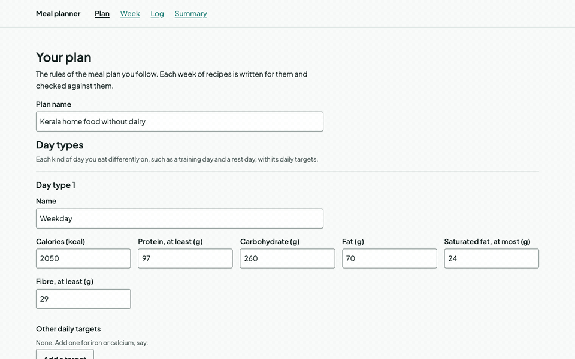
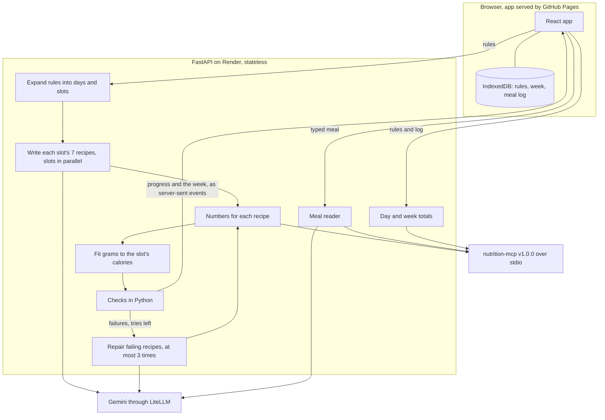

# meal-planner-agents

Writes a week of recipes for the meal plan you already follow, checks every nutrition number and rule in code through [nutrition-mcp](https://github.com/Varun-Kambali/nutrition-mcp), and tracks the meals you eat against the plan.

[](https://github.com/Varun-Kambali/meal-planner-agents/actions/workflows/ci.yml) [](LICENSE) · **[Live demo](https://varun-kambali.github.io/meal-planner-agents/)** · **[Case study](docs/case-study.md)**



The browser app on a week the pipeline wrote, replayed from recorded model replies, with every number from nutrition-mcp: the saved plan, the week with each recipe's checks, one recipe with household measures, breakfast logged as planned, and a day against its targets. The summary and the day come from the recorded log, so they do not count the breakfast just logged. [`frontend/scripts/demo-gif.ts`](frontend/scripts/demo-gif.ts) makes the GIF and calls no model.

## Problem

Following a meal plan means turning every slot of it into something to cook: a recipe that hits the slot's numbers, uses the gear you own, fits the time you have, and doesn't taste like yesterday's. Recipes online are written for someone else's kitchen, and chat assistants guess the nutrition numbers. Details are in the [case study](docs/case-study.md).

## Solution

- Enter your plan's rules once, in a form or as a rules file: day types with their targets, what each meal should be, your gear, time limits and food rules.
- A LangGraph pipeline writes the week. One model call writes each slot's 7 recipes (a slot is a meal of the day, such as breakfast), nutrition-mcp gives every number over MCP, code scales a recipe's grams to its slot's calories, plain Python checks each recipe and day, and a failing recipe goes back with its failures at most 3 times. The page shows each slot as it is written, checked and repaired.
- Each recipe has its grams, with a household measure where one is known, short steps and 16 nutrients, and prints on its own A4 page.
- Log each planned meal with one tap, type what you ate when you went off plan and confirm each food it was read into, and see each day and the week against your targets.
- Your plan, week and log stay in your browser, with export and import as one file. The API stores nothing.

Every feature, with what it must do, is in [docs/requirements.md](docs/requirements.md).

## Results

The newest full run of `make eval`: model gemini/gemini-3.1-flash-lite, commit 50aab53, dataset 4a35ea1576a9, started 2026-10-27. Every number below is in [`evals/results/2026-10-27_gemini-gemini-3.1-flash-lite_50aab53.json`](evals/results/2026-10-27_gemini-gemini-3.1-flash-lite_50aab53.json), and [`evals/results/summary.md`](evals/results/summary.md) has these tables with the checks that failed or could not be settled.

**Recipes.** Each of 20 synthetic plans gets a week from the agent pipeline and from a baseline that writes the whole week in one model call, with the same plan lines and ingredient list and no portion fitting or repair. The same code checks both. A recipe's own checks are counted on the recipe, and a day's checks on the day.

| Measure | Baseline | This project |
|---|---|---|
| Recipes passing every recipe check (share) | 8.3% (46 of 553) | 86.6% (479 of 553) |
| Recipes passing every recipe check at their first attempt (share) | 8.3% (46 of 553) | 46.7% (258 of 553) |
| Recipes passing the variety checks (share) | 65.1% (360 of 553) | 94.4% (522 of 553) |
| Days passing every check (share) | 2.1% (3 of 140) | 51.4% (72 of 140) |
| Days the checks could not settle (share) | 1.4% (2 of 140) | 20.0% (28 of 140) |
| Weeks where every recipe and day passes (share) | 0.0% (0 of 20) | 5.0% (1 of 20) |
| Weeks with no failing recipe or day (share) | 0.0% (0 of 20) | 30.0% (6 of 20) |
| Recipes written (share) | 98.7% (546 of 553) | 100.0% (553 of 553) |
| Model calls per week (mean) | 1.0 | 12.6 |
| Tokens per week (mean) | 11,654.2 | 85,323.7 |
| Cost per week at list price (mean) | $0.009117 | $0.040083 |
| Seconds per week (p95) | 58.3 | 143.6 |

**Reading.** 53 typed meals, each labelled with its foods and amounts, every label checked against nutrition-mcp. Five name a food the reader cannot reach today, and are shown on their own.

| Measure | All meals | Expected misses (m01, m02, m03, m15, m52) | Other meals |
|---|---|---|---|
| Meals | 53 | 5 | 48 |
| Food precision | 97.6% (80 of 82) | 75.0% (6 of 8) | 100.0% (74 of 74) |
| Food recall | 92.0% (80 of 87) | 66.7% (6 of 9) | 94.9% (74 of 78) |
| Status accuracy | 90.8% (79 of 87) | 66.7% (6 of 9) | 93.6% (73 of 78) |
| Asked when it should (share) | 93.8% (15 of 16) | 50.0% (1 of 2) | 100.0% (14 of 14) |
| Labels that ask, food not returned by the reader | 1 of 16 | 1 of 2 | 0 of 14 |
| Calorie error against the label (MAPE) | 6.4% over 42 meals | 29.3% over 5 meals | 3.3% over 37 meals |
| Foods not in the data reported missing (share) | 100.0% (19 of 19) | 100.0% (1 of 1) | 100.0% (18 of 18) |
| Reads that failed | 1 of 53 | 0 of 5 | 1 of 48 |
| Model calls per meal (mean) | 1.15 | 1.20 | 1.15 |
| Tokens per meal (mean) | 817.8 | 856.6 | 813.8 |
| Cost per meal at list price (mean) | $0.000304 | $0.000318 | $0.000303 |
| Seconds per meal (p95) | 43.7 | 16.7 | 43.7 |

What this shows: the single call misses slot calories on most recipes (460 of 553). The pipeline, with portion fitting and nutrient hints, passes 258 recipes at the first attempt against the single call's 46, and repair takes it to 479. The run does not separate portion fitting from the pipeline's other differences (the hints, a call per slot, its own prompt); [0005](docs/decisions/0005-code-fits-portions.md) gives the reasoning for fitting. Days are the weak point: 72 of 140 pass. 28 more cannot be settled, all on fibre: a food in the day, most often moong dal, curry leaves or moth beans, has no fibre value in the food data, so the check can show the day neither meeting its target nor missing it, and no recipe is rewritten for it ([0009](docs/decisions/0009-unsettled-day-checks.md)). For the pipeline, saturated fat fails the most days (21), each over the cap on the values the data has. The pipeline spends 12.6 model calls a week to the baseline's one. One meal read timed out at the model's API and counts as failed: its three foods count as not found and its calories as a full miss. Cost is LiteLLM's list price for the paid tier; the free tier billed nothing.

What it does not show: this is one run of one free-tier model on synthetic plans and meals, so the spread between runs is unknown. An earlier full run, from before a day check could be unsettled, is in [`evals/results/2026-10-27_gemini-gemini-3.1-flash-lite_b593c44.json`](evals/results/2026-10-27_gemini-gemini-3.1-flash-lite_b593c44.json); the [case study](docs/case-study.md) says what changed between the two.

CI replays a recorded slice of three plans and ten meals on every PR, with no key, and fails when a number drops ([0008](docs/decisions/0008-smoke-replay-gates-every-pr.md)).

## Architecture



The browser keeps everything about the user in IndexedDB and sends the plan's rules with each request. The API keeps nothing between requests. For a week, a LangGraph graph expands the rules into one entry per day and slot, writes each slot's 7 recipes in one model call (slots in parallel, at most 4 calls at once), and gets each recipe's 16 nutrients from nutrition-mcp's `compute_meal`. Code scales an off-target recipe's grams to its slot's calories and asks nutrition-mcp again. The checks are pure Python functions; a failing recipe goes back to the model with its failures, up to 3 times, and the page sees each step as it happens. The meal reader asks the model to list the foods and amounts in typed words, finds each with nutrition-mcp's search, and code settles the unit. The totals work out every eaten meal again from foods and amounts. The model never gives a number that reaches the user. The longer description, with the failure handling, is in [docs/architecture.md](docs/architecture.md).

## Tech stack

| Layer | Choice | Why |
|---|---|---|
| Language and tooling | Python 3.12, uv, ruff, mypy, pytest | One toolchain for build, lint, types and tests |
| Agent graph | LangGraph 1.2 | The write, number, fit, check and repair steps as a graph, with slots in parallel and a bound on repair |
| Model client | LiteLLM, `gemini/gemini-3.1-flash-lite` by default | One interface for any provider; the model id is a setting, and the default runs on Gemini's free tier |
| Nutrition numbers | nutrition-mcp v1.0.0 over stdio (MCP Python SDK 2.x) | Every number from one sourced server, started by the API as a subprocess |
| API | FastAPI, uvicorn, Pydantic | Server-sent events for the week; the models give the JSON Schemas the browser checks against |
| Tracing | Langfuse 5, off without keys | Steps, calls, tokens and cost per run, with the user's words masked |
| Browser app | React 19, Vite 8, TypeScript 7, IndexedDB | Static files any host can serve, and the user's data stays in the browser |
| Browser checks | Vitest, pa11y-ci with axe, Ajv validators compiled ahead of time | Tests, WCAG 2 AA checks on every screen, and file checks with no `eval` in the page |
| Container, CI and hosting | Docker, GitHub Actions, gitleaks, Render free web service, GitHub Pages | The image is built and called in CI; the demo costs nothing |

## Quickstart

```bash
git clone https://github.com/Varun-Kambali/meal-planner-agents && cd meal-planner-agents
make setup              # needs uv and Node 26 or later (the version CI tests)
cp .env.example .env    # set GEMINI_API_KEY to a free key from Google AI Studio
make run                # the API on 127.0.0.1:8000 and the app on 127.0.0.1:5173
```

Open http://127.0.0.1:5173. `make run` starts nutrition-mcp with the API, and Ctrl-C stops both servers.

## Use it

**In the browser.** Enter the plan on the Plan screen, or load a rules file under "Your data" (for example [`tests/fixtures/plans/office_weekday.json`](tests/fixtures/plans/office_weekday.json)). The Week screen writes the week and can write one recipe again. Each recipe opens on its own page, and "Print every recipe" lays the week out one recipe to an A4 page. The Log screen opens on today: each planned meal is logged as planned, at a different amount, swapped or skipped, and a swapped meal is typed in words and confirmed food by food. The Summary screen shows the week and each day against the plan's targets. "Export a copy" saves everything as one file.

**From the command line.** Each command starts nutrition-mcp itself. `week` and `read` call the model and need the key in `.env`; `summary` does not.

```bash
uv run --env-file .env meal-planner week tests/fixtures/plans/office_weekday.json --out week.json
uv run --env-file .env meal-planner read "2 rotis and a katori of dal"
uv run meal-planner summary tests/fixtures/plans/office_weekday.json tests/fixtures/logs/office_weekday_log.json
```

`week` writes a week of recipes for a rules file, `read` turns a typed meal into foods and numbers, and `summary` adds up a meal log against the plan. The log in the example is made up, for the same plan.

**Over HTTP.** `make run-api` starts the API alone on 127.0.0.1:8000, and `/docs` lists every route with its schema.

| Route | Does |
|---|---|
| `POST /v1/week` | Writes a week for the rules, streamed as server-sent events |
| `POST /v1/week/replace` | Writes one recipe of a week again and streams the week |
| `POST /v1/log/read` | Reads a typed meal into nutrition-mcp foods, amounts and numbers |
| `POST /v1/summary` | Adds up a meal log against the plan, date by date |
| `POST /v1/foods/search` | Searches nutrition-mcp's foods by name, with no model call |
| `POST /v1/log/compute` | Works out a meal's numbers from its foods and amounts, with no model call |
| `GET /v1/catalogue` | The ingredients the plan form can offer |
| `GET /healthz` | Says the API is up |

**Tracing.** To trace `week`, `read` and the API in [Langfuse](https://langfuse.com), set `LANGFUSE_PUBLIC_KEY` and `LANGFUSE_SECRET_KEY` in `.env`. Each run's steps, model calls, tokens, cost and failed checks are sent with the plan's words and the typed text masked; without the keys nothing is sent ([0010](docs/decisions/0010-masked-langfuse-tracing.md)). [`docs/media/trace.png`](docs/media/trace.png) shows a traced week and meal read in Langfuse.

**With Docker.**

```bash
docker build -t meal-planner-agents .
docker run --rm -p 8000:8000 -e GEMINI_API_KEY meal-planner-agents   # the key is read from your environment
```

The API answers on `http://127.0.0.1:8000`; `/healthz` says it is up. The image holds the API and its data, not the browser app, and runs as a user without root. Set `PORT` to serve on another port, as free hosts do. CI builds the image, starts it with a placeholder key and calls `/healthz` and `/v1/catalogue`, neither of which calls a model.

The rate limit counts requests per client address. By default the image trusts no forwarded address, so a client cannot choose the address it is counted under. Behind a host's proxy every visitor would share the proxy's address. On Render, leave `FORWARDED_ALLOW_IPS` unset, because Render's proxy appends to an `X-Forwarded-For` the client sent and its leftmost entry can be forged. Set `MEAL_PLANNER_CLIENT_ADDRESS_HEADER=CF-Connecting-IP` instead: Cloudflare, which sits in front of Render, sets that header itself ([0012](docs/decisions/0012-count-visitors-by-cf-connecting-ip.md)). The header is read only when the setting names it.

Every other setting, with its default, is in [`.env.example`](.env.example).

## Evaluation

Two suites, run by `evals/run_evals.py` against nutrition-mcp started as the app starts it. The datasets are in [`evals/datasets/`](evals/datasets/README.md), made up for this project, with a version hash that every results file records.

- **Recipes.** 20 synthetic plans in the app's rules format, covering the four diets, one to four day types, three to five slots a day, 19 gear sets, active-time limits from 5 to 45 minutes, and regional Indian, Japanese, Korean and Mediterranean cooking. Two are meant to fail: a vegan plan made in jars with no heat, and a vegetarian plan with no dairy and only a kettle, each asking for half its energy from protein ([`plans/README.md`](evals/datasets/plans/README.md)). Each plan gets a week from the pipeline and from the single-call baseline (`evals/baseline.py`), and the graph's own checks score both. The headline is the share of recipes that pass every recipe check, counted over the recipes the plans ask for, so a recipe never written counts as failing. The run also reports first-attempt and variety pass rates, days and weeks passing, days left unsettled, calls, tokens, cost per week and p95 time.
- **Reading.** 53 typed meals in plain Indian English, with 87 labelled foods (71 the reader should match, 11 that need an amount, 5 with a unit the data lacks) and 19 foods that are not in the data. Every matched label's grams are what nutrition-mcp gives for that food and unit, checked against the real server by `tests/integration/test_datasets_live.py`, so no label is an estimate. Measures: food precision and recall, status accuracy, how often the reader asked when it should, calorie error against the label, and the share of missing foods reported missing.

No model judges anything: every score is computed by code. To reproduce, put `GEMINI_API_KEY` in `.env` and run `make eval`; a run that stops keeps what it finished, and `make eval EVAL_ARGS="--resume evals/results/runs/<name>"` finishes it. A full run from a clean tree writes a results file named by date, model and commit and rebuilds `evals/results/summary.md`. `make eval-smoke` replays the recorded slice with no key.

The full run above made 251 model calls for the pipeline ($0.801663), 20 for the baseline ($0.182336) and 61 for the reader ($0.016136), at LiteLLM 1.105.1's list price for the paid tier. On the free tier it billed nothing.

## Testing

- `make test`: pytest with a coverage gate of 80% over `src/` and `evals/`. Unit tests use a fake model and a fake nutrition-mcp; integration tests in `tests/integration/` start the real nutrition-mcp over stdio.
- `make lint`: ruff and mypy.
- `make eval-smoke`: the recorded slice through the real checks and nutrition-mcp, held to `evals/thresholds.toml`.
- In `frontend/`: `npm run test:coverage` (Vitest, holding `storage.ts`, `validate.ts`, `mealLog.ts`, `swap.ts`, `planForm.ts` and `api.ts` to 80% each), and `npm run a11y`, which runs pa11y-ci with axe at the WCAG 2 AA level over the 17 screens in `pa11y.json`, at desktop and phone width, in the light theme and the dark one.

CI runs all of them on every PR and every push to `main`, in six jobs: `check` (lint, tests, and the JSON Schemas against the models), `eval-smoke`, `frontend` (types, validators, lint, format, type check, tests with coverage, and the build), `a11y`, `image` (builds the Docker image, starts it and calls it) and `secrets-scan` (gitleaks).

## Deployment

The API runs as a Render free web service in Ohio, built from the Dockerfile as [`render.yaml`](render.yaml) describes. The browser app is built and published to GitHub Pages by the [`pages` workflow](.github/workflows/pages.yml). Your plan, week and log stay in your browser either way. The plan's rules, and the words typed for a swapped meal, are sent to the model (Google's Gemini API, on a free-tier key in the demo) to write recipes and read meals. Google's terms for its free tier let it use what is sent to improve its products. The API stores nothing. Why this host and region is in [0011](docs/decisions/0011-demo-on-render-and-pages.md).

**What a visitor feels of the free host.** Render stops the service after 15 minutes without a request and starts it again on the next one, which takes about 70 seconds (one test: 71.4 s after 16 idle minutes). The first service, in Singapore, never woke after a sleep. While the server starts, the page says the demo server is starting and tries again until it answers. After two minutes without an answer it says so, asks the visitor to try again in a few minutes, and keeps checking every 30 seconds.

**Limits on the demo**, as the code sets them:

- Each visitor may make 10 requests a minute to the `/v1` routes (`MEAL_PLANNER_RATE_LIMIT_PER_MINUTE`). Over that the API answers 429 with a `Retry-After`. A visitor is counted by the address in `CF-Connecting-IP`, which Cloudflare in front of Render sets itself (`MEAL_PLANNER_CLIENT_ADDRESS_HEADER`); a request without it is counted under the connection's address.
- A request body over 64 KiB is refused with a 413, and over 128 KiB for replacing one recipe, which sends the rest of the week back. A typed meal is at most 500 characters.

**Spend cap.** The model key belongs to a Google AI Studio project with no billing account, so the free tier's quota is the most it can use and nothing can be charged. When that quota is used up, Gemini answers with a rate limit and the API reports it where it happens. For a week, the response is still a 200 stream: the slots the model would not write are listed as unwritten with the reason `rate_limited`, and the page shows them as "the model's rate limit was reached". A new week in which no recipe could be written is not saved, so the week the visitor had stays. For a typed meal the API answers 503 with "the model could not be reached (step: read_meal)". Everything that calls no model, such as the summary and the catalogue, keeps working.

**Deploy a copy.**

1. Change `MEAL_PLANNER_CORS_ORIGINS` in `render.yaml` from `https://varun-kambali.github.io` to your own Pages origin, so the browser lets your page call the API. Do this first: Render reads the file when the service is created.
2. In Render, create a Blueprint from your fork of this repository. It reads `render.yaml`; enter `GEMINI_API_KEY` when asked, from a Google AI Studio project with no billing account.
3. In your repository's settings, set the Actions variable `MEAL_PLANNER_API_BASE` to the service's address, such as `https://meal-planner-agents.onrender.com`, with no trailing slash.
4. Set Pages to build from GitHub Actions (Settings, Pages, Source).
5. Run the `pages` workflow from the Actions tab. It does nothing while the variable is unset.

The demo is live at [https://varun-kambali.github.io/meal-planner-agents/](https://varun-kambali.github.io/meal-planner-agents/), with the API at https://meal-planner-agents.onrender.com.

## Project structure

```
src/meal_planner/         the API, the week graph, checks, portion fitting, measures, reader, totals, CLI
src/meal_planner/prompts/ the writer, repair and reader prompts
frontend/                 the React app, its tests, the accessibility check and the demo GIF script
data/                     the catalogue and this project's food file for nutrition-mcp
data_build/, scripts/     the reviewed food map and the scripts that build the food file and schemas
schemas/                  JSON Schemas written from the models, for the browser and the API
evals/                    the eval runner, datasets, recordings, thresholds and results
tests/                    unit and integration tests, and the container test
design-system/            the app's colours, type and spacing
docs/                     case study, requirements, architecture, data notes, decisions
```

## Design decisions

- [0001](docs/decisions/0001-follow-an-existing-plan.md) Follow the plan the user already has instead of writing one.
- [0002](docs/decisions/0002-model-writes-code-checks.md) The model writes recipes; code checks every number and rule.
- [0003](docs/decisions/0003-foods-through-nutrition-mcp-datasets.md) New foods reach nutrition-mcp through its custom-dataset folder.
- [0004](docs/decisions/0004-user-data-in-the-browser.md) The user's data stays in the browser, and the API keeps no state.
- [0005](docs/decisions/0005-code-fits-portions.md) Code fits portions, and the writer is shown nutrition per 100 g.
- [0006](docs/decisions/0006-reading-a-typed-meal.md) The model reads a typed meal and picks among nutrition-mcp's options; code checks amounts and units, and nutrition-mcp gives the numbers.
- [0007](docs/decisions/0007-the-log-holds-foods-and-amounts.md) The meal log holds foods and amounts, and the server works out the numbers.
- [0008](docs/decisions/0008-smoke-replay-gates-every-pr.md) A replay of the smoke slice gates every PR, held to its own numbers.
- [0009](docs/decisions/0009-unsettled-day-checks.md) A day check that cannot tell is unsettled, and saturated fat is bounded by total fat.
- [0010](docs/decisions/0010-masked-langfuse-tracing.md) Traces are made by this code, masked twice, and off without keys.
- [0011](docs/decisions/0011-demo-on-render-and-pages.md) The demo runs on a Render free web service in Ohio and on GitHub Pages, since free Docker Spaces are gone and Singapore never woke.
- [0012](docs/decisions/0012-count-visitors-by-cf-connecting-ip.md) The rate limit counts `CF-Connecting-IP`, because Render's proxy keeps a forged `X-Forwarded-For`.
- [0013](docs/decisions/0013-household-measures-in-code.md) Household measures are worked out on the server from the final grams, never in a prompt.
- [0014](docs/decisions/0014-browser-file-checks-compiled-ahead.md) The browser repeats the server's file checks, with validators compiled ahead of time.

## Limitations and next steps

**The results**
- One run of one free-tier model on synthetic plans and meals, so the spread between runs is unknown.
- 28 of 140 days are unsettled on fibre because a few dals and curry leaves have no fibre value in the food data, which needs a data fix rather than code.
- Saturated fat still fails 21 days on the values the data has.

**Recipes**
- Cooking time is the model's claim, checked against the slot's limits but never measured.
- A style such as "no-cook" is free text that no code checks.
- Scaling is uniform, so an egg can land on a fraction of a piece.
- Glycemic load is often unknown, because USDA foods carry no glycemic index.
- Variety is limited by the catalogue, and a larger licensed food table would widen it without code changes.
- Liquids read in glasses where the data's glass is bigger than its cup (200 g milk is ¾ glass).

**Reading a meal**
- A household measure with no sourced weight, such as a bowl or a pav, is not converted, so the reader asks for a katori or grams.
- Which dish a general name means is the model's pick, from nutrition-mcp's search results.
- A food read wrongly can be changed to another but not removed; reading the meal again in other words is the way round it.

**Tracking and the browser**
- The log holds 7 consecutive days; a meal past that starts a new log once the old one is exported, and the old one then lives only in that file.
- Two open tabs overwrite each other's saves.
- Clearing the browser loses the data unless it was exported.
- Loading a rules file always clears the week, even when its rules are the ones already saved, and a rules file with one mistake is refused with the export format's problems, which are harder to read than the rules format's would be.
- The share eaten as planned counts a meal with no log entry as not as planned.
- When a food in a day has no value for a nutrient and the day still meets that nutrient's floor, the day view shows the total without "at least", so it can read as complete.

**The demo**
- Every visitor shares one free model quota, and the rate limit counts requests, not model calls, so one visitor can use a large part of it.
- `/healthz` does not check nutrition-mcp, so if it stops, the health check stays green while the `/v1` routes answer 503 until the service sleeps and starts again.
- The rate limit's count is in memory, so a restart starts it again.
- The Ohio service's wake has been timed once (71.4 s), which shows it can wake, not that it always will.
- The Pages workflow deploys on a push to `main` without waiting for CI, which matters only for a push that skips a PR.
- Traces keep ids and numbers (targets, food ids, grams); only words are masked.

Next: the food-data review that settles the fibre days, a process-wide cap on model calls, a `/healthz` that asks nutrition-mcp, saves that reload when another tab writes, and a stronger model, which is a setting and which the eval can price.

## What I learned

- **Arithmetic belongs in code even inside a generation loop.** The single call passed 46 of 553 recipes, most of the rest missing their slot's calories. The pipeline, which scales grams in code and shows the writer nutrition per 100 g, passed 258 at the first attempt and 479 after repair ([results file](evals/results/2026-10-27_gemini-gemini-3.1-flash-lite_50aab53.json)). That run does not measure fitting on its own; why fitting is in code is in [0005](docs/decisions/0005-code-fits-portions.md).
- **A check that cannot tell has to say so.** Counting a missing value as zero would let days pass on numbers nobody measured, and failing those days, as the first full run did, published days as failing that could not be judged. A third verdict showed 28 of 140 days the data cannot settle, and repair no longer rewrites recipes for a gap in the data ([0009](docs/decisions/0009-unsettled-day-checks.md)).
- **An eval can gate CI only when it gives the same answer twice.** A live run varies, so thresholds on it would need wide margins. Replaying recorded replies through the real checks gives the same numbers on every run, so the thresholds sit within one recipe of the replay ([0008](docs/decisions/0008-smoke-replay-gates-every-pr.md)).
- **What to mask is decided by the field, not by how a string looks.** A cuisine such as `south_indian` looks like an id, so a pattern cannot tell it from one. Masking every string except those under a short list of id fields kept the plan's words out of the first real traces ([0010](docs/decisions/0010-masked-langfuse-tracing.md)).
- **A proxy header is only as good as the hop that sets it.** Render's proxy appends to an `X-Forwarded-For` the client sent, so trusting it would let a visitor pick its own count. Counting `CF-Connecting-IP` held: with forged headers, the eleventh request in a minute still got a 429 ([0012](docs/decisions/0012-count-visitors-by-cf-connecting-ip.md)).

## License and data

The code is MIT. This project's food file in [`data/foods/`](data/foods/LICENSE.md) and the catalogue's household measures come from USDA FoodData Central (public domain). nutrition-mcp's bundled data, which gives the rest of the numbers, comes from USDA FoodData Central (public domain), CoFID 2021 (Open Government Licence v3.0), its own dish recipes (CC BY 4.0) and a compendium of glycemic index values for non-Western foods (CC BY 4.0); its [license file](https://github.com/Varun-Kambali/nutrition-mcp/blob/main/src/nutrition_mcp/data/bundled/LICENSE.md) has the attribution for each. The eval plans and typed meals are made up for this project. How each food record was chosen is in [`docs/data.md`](docs/data.md).
