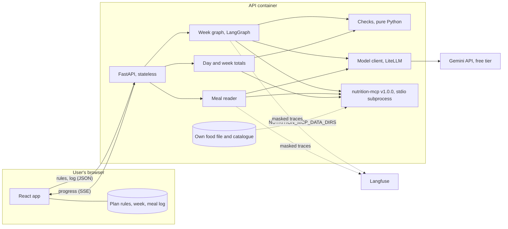
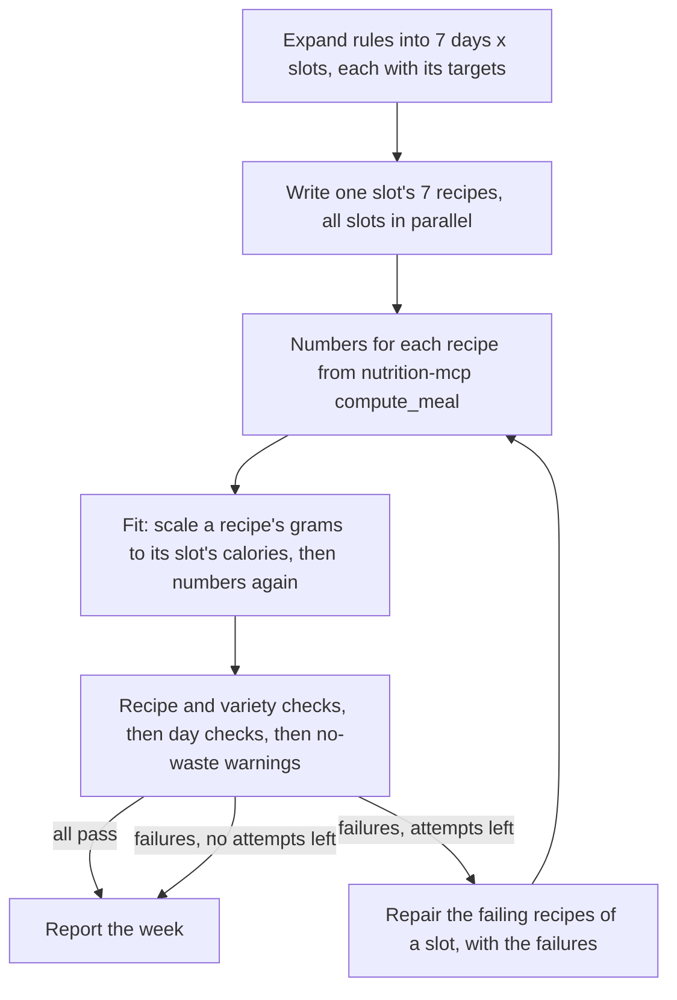
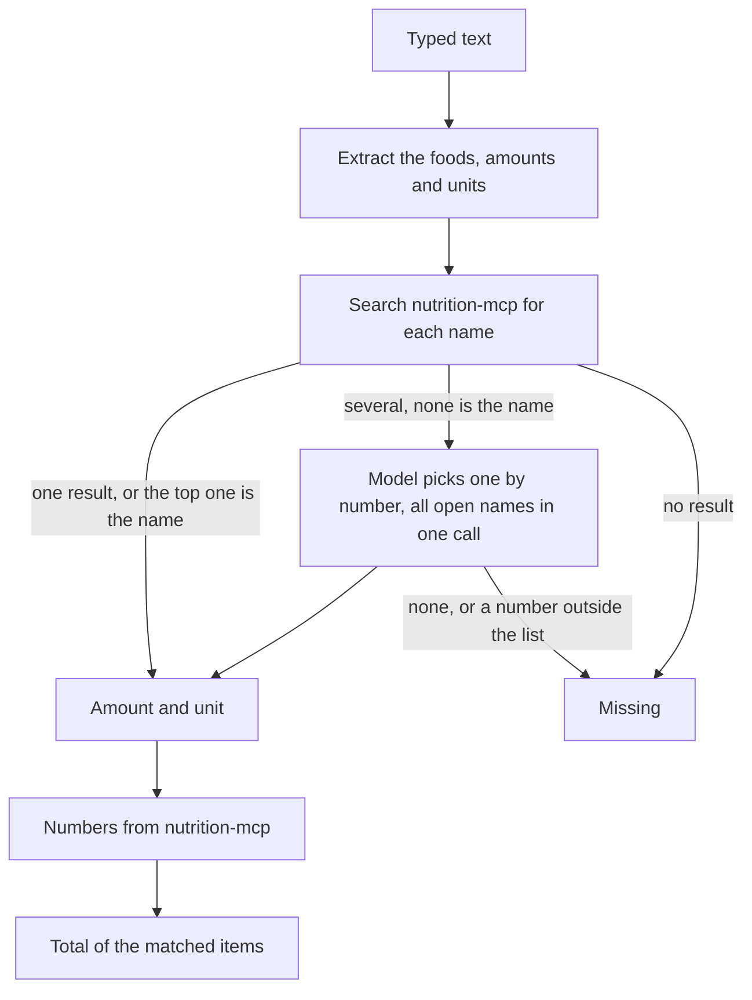

# Architecture

Status: agreed at kickoff on 2026-10-21, and brought in line with the code when the recipe pipeline was finished, on 2026-10-24, again when the meal reader and the day and week totals were added, on 2026-10-25, and after their review, on 2026-10-26. What the system must do is in [requirements.md](requirements.md); why it is built this way is in [case-study.md](case-study.md).

Built so far: the week graph, the checks, the meal reader, the day and week totals, the HTTP API for writing and replacing a week, reading a typed meal and summarising a log, and a command line with `week`, `read` and `summary`. The eval runner is built and has not been run with a model yet. Tracing, the frontend and the deployed demo are still to come, and the sections on them say so.

## Overview

The browser holds everything about the user. Each request sends the plan rules (and, for summaries, the log) to a stateless API. The model writes recipes and reads typed meals; nutrition-mcp supplies every nutrition number; plain Python decides whether each recipe and day passes. Nothing about the user is written to disk on the server.

## Modules (`src/meal_planner/`)

| Module | Does |
|---|---|
| `rules.py` | Pydantic models for the plan rules (day types, targets, slots, gear, food rules, shopping days) and the JSON Schema export. A day type's extra targets are for nutrients it has no field for: one that repeats calories, protein, carbohydrate, fat, saturated fat or fibre, or names a nutrient twice, is refused with the field named |
| `catalogue.py` | Loads `data/catalogue.yaml`, the ingredients the writer may use, with allergen groups, pack size, shelf life and grams per household measure. Checks every id against nutrition-mcp at startup and keeps each food's nutrients per 100 g from the same call. `meal_item` settles the unit of a food eaten for the reader and the summary alike (see Reading a typed meal, step 4) |
| `nutrition.py` | The nutrition-mcp client: one MCP session over stdio, typed wrappers for `search_food`, `get_nutrition` and `compute_meal`, timeouts and error mapping |
| `llm.py` | The model client: model id from config, timeouts, retries that back off with jitter and follow a provider's Retry-After, structured output into Pydantic models, and a log line with tokens, latency and cost for every call. A reply that cannot be used comes back with an error code, never as an exception. Also the fake, recorder and replayer that tests and the smoke eval use |
| `log.py` | JSON log lines on stderr that carry only an allowlist of fields (task, model, tokens, latency, cost, error, error type) and the request id, so no rule or typed text can reach a log |
| `recipes.py` | The models a recipe passes through: what the writer returns (`DraftRecipe`, `SlotDraft`), a recipe with its numbers and failures (`CheckedRecipe`), and a day's totals and failures (`DayReport`) |
| `checks.py` | Pure functions, one per hard check. Each returns pass or fail and a reason the model can act on ("protein 31 g, slot needs at least 36 g"). A number in a reason is whole when whole units are within 2% of it and has one or two decimals when they are not, so a limit of 2.4 ug is not shown as 3; rounding goes up for a floor and down for a cap. A list of foods with no value for a nutrient names foods only, as a person reads them ("mustard oil"), also for a recipe nutrition-mcp could not work out, which lacks all its ingredients. `add_up_meals` adds up a day's meals for both the day checks and the summaries |
| `portions.py` | Fits a recipe's grams to its slot's calories: the scale factor and the scaled draft. Arithmetic on grams only |
| `week.py` | The LangGraph graph that writes, checks and repairs a week, and `run_week` and `replace_recipe`, which run it |
| `week_events.py` | The events the graph streams to the client and the `WeekResult` that the last one carries |
| `week_prompts.py` | The writer and repair prompts: the system prompt with the catalogue filled in, and the user message built from the slot, the failures and the summaries of the slot's other recipes. String building only; it makes no model call. Also the two helpers that load a prompt file and quote text into a data block, which the reader uses too |
| `summary.py` | The meal log (`MealLog`, its entries and foods), the export file (`Export`), and `summarise`, which works each eaten meal out with nutrition-mcp and holds each date's total to the targets of its day type (see Day and week totals) |
| `reader.py` | Turns a typed meal into nutrition-mcp foods, amounts and numbers (see Reading a typed meal). One model call to list the foods and, when nutrition-mcp's search leaves names open, one more to pick among its options for all of them. Code decides whether each amount is usable (the model's number must be the one its words give), settles the unit and sets the status of each item, and nutrition-mcp gives the numbers |
| `prompts/` | The system prompts as Markdown: `writer.md` and `repair.md`, with a placeholder for the catalogue, and `reader.md` and `choose_food.md` for the meal reader |
| `startup.py` | What has to be true before the app answers: LangSmith tracing off, the model's key set (unless the work makes no model call, as with `meal-planner summary`), nutrition-mcp running, the catalogue loaded against it. Each way it fails ends in one line saying why. Shared by the API and the command line |
| `problems.py` | Invalid input in one form for the API and the command line: where it is and what is wrong. The location of an unknown liked or excluded food comes from the catalogue check as data, not from the wording of its message. The rejected value is dropped from validation errors, because it is the user's rules, and nothing is logged. A few messages name an id so it can be fixed, such as an unknown liked or excluded food, an undefined day type or a slot the plan lacks. A typed meal that is blank is said to be blank, and one that is too long gives its length and the limit. Neither message holds any of the text |
| `middleware.py` | The request id, the body size limit and the rate limit, as plain ASGI middleware. Starlette's `BaseHTTPMiddleware` buffers around streams, and the week is a stream |
| `api.py` | FastAPI routes, server-sent events and CORS |
| `cli.py` | `meal-planner week <rules.json>`: the same graph without the web server, with progress on stderr and the week as JSON. `meal-planner read "<text>"`: reads a typed meal and prints the result as JSON. `meal-planner summary <rules.json> <log.json>`: adds up a meal log against the plan and prints the week summary as JSON |
| `config.py` | Settings from environment variables (`pydantic-settings`) |

Not built yet: `tracing.py` (Langfuse setup and the masking of user content). The frontend will live in `frontend/` (React, Vite, TypeScript), store the rules, the week and the log in the browser, and only display numbers the API returns.

## Writing a week

1. **Expand (code).** The rules become one entry per day and slot, each with its calorie and protein share of that day type's targets, its style, its time limits and the food rules.
2. **Write (model).** One call per slot writes that slot's 7 recipes together, so the model can see its own recipes and keep them different. The slots run in parallel, with at most `MEAL_PLANNER_MAX_CONCURRENT_MODEL_CALLS` model calls (default 4) in flight at once, so a free-tier rate limit is not hit by every slot together. The call gets the slot's targets, the rules, the cuisines to draw on and the catalogue as a list of ids and names, and returns recipes as structured output with ingredient ids and grams. Liked foods that the plan's diet, allergens or excluded foods rule out are not listed to it, and the instruction not to repeat a cuisine on neighbouring days is in the prompt only when the plan lists more than one cuisine. With `MEAL_PLANNER_WRITER_NUTRIENT_HINTS` on (the default), each catalogue line also carries the food's calories, protein, saturated fat, fibre and sodium per 100 g from nutrition-mcp, and each day's target adds the slot's share of that day type's saturated-fat cap, fibre floor and extra targets (caps rounded down, floors up). The prompt says the grams are the weight of the ingredient as listed, that the slot's style is binding, and that the steps name ingredients without amounts (code may change them). The writer is never asked for nutrition numbers, and none it writes is used: a figure in its text fails the recipe (step 5).
3. **Numbers (nutrition-mcp).** `compute_meal` gives each recipe's nutrients and glycemic load. A recipe with an ingredient id outside the catalogue is not sent; the catalogue check fails it. If nutrition-mcp cannot be reached, it is asked once more; if it still cannot be, the recipe has no numbers and is marked `nutrition_unavailable`. If it answers but refuses the recipe, or sends a result that cannot be read, the recipe has no numbers and is marked `nutrition_failed` (see Errors).
4. **Fit (code).** With `MEAL_PLANNER_FIT_PORTIONS` on (the default), a recipe written or repaired in this run whose calories are fully known and outside the slot's band has every gram multiplied by one factor, the slot's calories over the recipe's, rounded to whole grams (at least 1 g). The scaled recipe goes back to nutrition-mcp for its numbers, so no nutrient is multiplied in code. The factor must be within `MEAL_PLANNER_PORTION_SCALE_MIN` and `MEAL_PLANNER_PORTION_SCALE_MAX` (0.5 and 2.0), and no ingredient may pass 1000 g; otherwise the recipe is left to fail the slot check and go to repair. Fitting is not an attempt, and the recipes a replacement keeps are never fitted. The recipe records its factor as `portion_scale`. If nutrition-mcp cannot work out the scaled recipe, the recipe stays as the writer gave it, with its first numbers.
5. **Check (code).** Each recipe is checked for its ingredient ids and the plan's food rules (diet, excluded foods, allergens), its slot targets, its gear, its minutes (each within the slot's limit, and the active time no more than the total) and its text. A title, step, store, swap or fits line that names a nutrition figure, meaning a number next to a word such as calories, protein, fat, fibre, sugar, sodium or salt in either order, fails as `model_figure` and quotes what it says. Variety is checked within each slot: the same title, mostly the same ingredients, a cuisine outside the plan's list, or, when the plan lists more than one cuisine, the same cuisine on neighbouring days. A clash is blamed on one of the two recipes: first a recipe this run may rewrite over one it may not, then the one written in the latest round, then the later day. That way a recipe that already passed is not rewritten because another one changed. Every day's totals are worked out against its day type (daily targets, caps and floors). When a day misses a target and all its slots are there, the failure goes to the recipe that most explains the miss, once per failed check, and only if none of that day's recipes this run may rewrite fails a check of its own. The no-waste check runs on the whole week. Its findings are warnings (`no_waste` in the result): no one recipe is to blame, so nothing is repaired for them.
6. **Repair (model).** One call per slot rewrites only that slot's failing recipes. It gets the exact failures and short summaries of the slot's other recipes, so a fix doesn't break variety. A recipe is rewritten at most 3 times (`MEAL_PLANNER_MAX_REPAIR_ATTEMPTS`), so it is tried at most 4 times with the first writing. Output that doesn't parse, or has the wrong recipes for the days asked, counts as a failed attempt for the whole slot and the next call is told why; if the slot has no recipes yet it is written again. A recipe marked `nutrition_unavailable` is left out of repair, because the writer cannot fix that. A call that gets no reply at all ends repair for that slot (see Errors).
7. **Report (code).** Every recipe goes out with its numbers, its check results and how many times it was tried. A recipe that still fails says what it misses. A recipe that could not be written is listed with the reason. The week also carries the model calls made, the tokens used and, when LiteLLM has a price for the model, the cost.

A week therefore takes one writing call per slot (4 for a four-slot plan) plus at most 3 repair calls per slot. That keeps it inside free-tier quotas and makes the cost per week predictable. Fitting adds `compute_meal` calls (one more for each scaled recipe) and no model calls. Why it is done in code is in [ADR 0005](decisions/0005-code-fits-portions.md).

**Replacing one recipe** runs the same graph for a single day and slot, with the rest of the week passed in for the variety and day checks. The other recipes are never changed, and their grams and numbers are not sent to the model. Their one-line summaries (day, title, cuisine and ingredient ids) for the same slot are, so the writer can stay different from them. The old recipe leaves the week before the new one is checked, and stays if no new one could be written. Anything the new recipe clashes with, such as a dish or cuisine of a later day, or a day total that is out of range, is the new recipe's to fix: the recipes that stay are never blamed or rewritten.

**Why a graph of separate steps instead of one prompt with tools:** the model is good at combining ingredients and flavours and unreliable at arithmetic and rule-following, which nutrition-mcp's grounding run measured. Splitting the work gives each part to whichever side does it reliably, lets the slots run in parallel, and keeps repair targeted and bounded. The single-call baseline in the eval measures whether the extra steps are worth their cost.

## Reading a typed meal

1. **Extract (model).** One call lists the foods the text names, up to 20, each with a name, an amount, a unit and the words the person used for the amount (`amount_text`). The text goes in as a JSON string inside a delimited data block, with angle brackets escaped so that it cannot close the block, and the prompt says it is data and never instructions. The reply has no field for a nutrition figure, and anything extra in it is ignored. An item with no name is dropped.
2. **Match (nutrition-mcp).** Each name goes to `search_food`, for up to 5 results. The top result is taken when it is the only one, or when the name typed is its name, one of its aliases or its id, compared as nutrition-mcp's search spells words ("chapaati" is "chapati"). The names this leaves open go to one more model call together: each name with its numbered results, and the reply picks a result by its number, or none, for each name by the name's number. A name typed twice is asked about once. The call is shown the names and the results only, never the rest of the text, and it never writes an id. A name with no result, a name nutrition-mcp cannot search for (no letter or digit in it, or over 100 characters), a pick of `null`, a pick outside the list, no pick and two picks that disagree all leave the item `missing`.
3. **Amount (code).** The model's number is used only when its words for the amount (`amount_text`), with case and spaces folded, are in the text the person typed, and on their own there rather than inside a longer number or word ("2" in "12", "one" in "honey"), when they are neither vague nor a range, and when they give that number. Words the model made up ("roti and dal" read as amount 1 with the words "1"), blank amount text, a vague word (some, a little, a bit, few, handful, lots, several, many, plenty) or a range (2-3, 2 to 3, 2 or 3, two or three) makes the item `needs_amount` whatever number the model returned. So does an amount that is zero, negative, not a number or over 100,000. The item keeps its food and lists the units that would work, so that the person can give an amount. The number is checked against its words in code: `_amount_in` reads the number the words start with, and the model's amount is used only when it equals that number (to within 1e-9). It reads digits, with or without a unit attached ("2", "1.5", "200gm"), a fraction or mixed number ("3/4", "1 1/2") and a short table of words: a, an, one to twelve, half, a half, quarter, a quarter, dozen, a dozen and "one and a half". A different number ("a" with the amount 5) makes the item `needs_amount`. So do words the code reads no number from: Hindi number words ("ek"), "couple", a number word not in the table, and a number that goes on into something the table has no value for. The number counts as going on when a word after it joins, divides, scales or counts in parts ("two and a half", "three quarters", "one fourth", "half a dozen", "one point five", "twelve to fifteen", "five hundred", "1 lakh", "2 se 3", "2 aur teen", and the same joiners in Devanagari), when another number word of the table comes straight after it ("one two"), or when anything after it is a digit, a letter of a script other than Latin or Devanagari ("2三") or not a letter, a space or a full stop ("1,000 g", "1 litre 500 ml", "2~3", "1 & 1/2"). A fraction divided by zero ("1/0") has no number either. The code reads only the ways of writing an amount listed here, and asks when it reads no number or sees the words go on. It cannot see every way the words can go on: a number word it has no entry for, such as the Hindi "teen" in "2 teen", is read as the number before it. So the check narrows what the model can get wrong and does not make a wrong amount impossible.
4. **Unit (nutrition-mcp, then the catalogue).** A number with no unit word counts pieces, and the prompt has the model leave the unit null when the unit word is the food itself ("2 rotis", "2 eggs", "2 idlis"). Kilograms and litres (kg, kilo, litre, liter, l and their plurals) become grams and millilitres first, because nutrition-mcp reads only g and ml spellings; the prompt has the model keep the amount in the unit typed ("half kg" is 0.5 kg). The unit is then settled in code before nutrition-mcp is asked, from the units its search listed for the food, read the way it reads them (case, gram spellings and plurals). A unit nutrition-mcp has is sent by its own name. Otherwise, if the catalogue has the measure, its grams per measure turn the amount into grams ("2 eggs" becomes 100 g). The item keeps the amount and unit as typed. The summary reads a logged unit through the same function (`Catalogue.meal_item`), so a meal the reader matched is a log the summary accepts. A unit neither has makes the item `unknown_unit`, with the valid units of both; no measure is made up, so "2 pav" stays unknown. An amount nutrition-mcp refuses as over its 5000 g limit makes the item `needs_amount`; it refusing the item for any other reason is a failure of the read (see Errors).
5. **Numbers (nutrition-mcp).** Each matched item carries nutrition-mcp's numbers for its grams, and `compute_meal` adds up the matched items. A missing food is listed by name in `missing` and is not in the total, and neither is an item that needs an amount or has an unknown unit. The result has each item with its status (`matched`, `needs_amount`, `unknown_unit` or `missing`), the total, `missing` and the length of the text. The user is to confirm or edit it in the browser before it is saved; the frontend is not built yet.

A typed meal costs one model call, plus one more when any name has several results and the top one is not the name typed: at most two. These calls are short, so they have their own timeout (`MEAL_PLANNER_READER_CALL_TIMEOUT_S`, default 30 seconds). The names are searched one after another. Why the model's part is this small is in [ADR 0006](decisions/0006-reading-a-typed-meal.md).

## Day and week totals

`POST /v1/summary` takes the plan rules and a meal log and returns what was eaten, date by date, against the targets of each date's day type. The server keeps nothing: the log is the browser's. Why the log holds no numbers is in [ADR 0007](decisions/0007-the-log-holds-foods-and-amounts.md).

The log (`MealLog`, version 1) has an entry for each planned meal the person logged: its date, its slot, its status (`as_planned`, `different_amount`, `swapped` or `skipped`) and the foods eaten, up to 20, each a nutrition-mcp food id, an amount above 0 and a unit. It holds no nutrition number. It covers at most 7 consecutive days, which need not begin on a Monday. The export file (`Export`, version 1) is the rules, the week (or null) and the log, and `schemas/export.json` is its JSON Schema, for the browser to check a file against before it loads it.

1. **Check the log.** An entry names a slot the plan has, once for each date. A skipped meal lists no foods and any other lists at least one. A log that fails is refused with the entry named by its date and slot, and nothing is dropped quietly.
2. **Numbers (nutrition-mcp).** Each meal that was eaten is sent to `compute_meal`, one at a time. A skipped meal is not sent. Each food's unit goes through the reader's function (step 4 above): kilograms and litres become grams and millilitres, and a catalogue measure for a food nutrition-mcp has no such unit for becomes grams. Any other unit goes to nutrition-mcp, which reads it or refuses it. A refused unit's message lists the units the reader would list for that food (`Catalogue.valid_units`): nutrition-mcp's, then the catalogue's measures, so "piece" is listed for an egg. A food, amount or unit nutrition-mcp refuses refuses the entry: the refusal names the date, the slot, the item and the food, every such entry is named at once, and nothing is added up.
3. **Add up (code).** The meals of a date are added up with `add_up_meals`, the function the day checks use, so a nutrient no eaten food has a value for is unknown (null), never 0, and a food that lacks one makes the total a lower bound. A date whose meals were all skipped totals 0 for every nutrient: nothing was eaten, which is known.
4. **Compare (code).** The date's day type is the plan's for its weekday, and `check_day_totals` holds the totals to it with the day tolerance from the settings. The failures read as the week's day failures do, and they name foods in words a person reads. Carbohydrate and fat are reported as fractions over or under their targets, and never fail a day.
5. **Week.** `planned_meals` is the plan's slots on every date from the log's first entry to its last, so a day with no entries between two logged days counts too. `as_planned_share` is the meals eaten as planned over that, so a slot with no entry counts against it, and it is 0 for an empty log. Only a date with entries gets a day summary. `days_on_target` counts the dates with no failure.

A meal's glycemic load, by slot, is shown only when every food in it has one. Otherwise it is null, and `gl_missing` says how many foods have none. Both are keyed by slot and hold the date's meals that were eaten. A day summary also carries its day type's targets by nutrient. The log holds no minimum or maximum, so the browser reads which is which from the rules.

## API

The API keeps no state. Six routes:

| Route | Does |
|---|---|
| `POST /v1/week` | Takes the plan rules as JSON and streams the week it writes |
| `POST /v1/week/replace` | Takes the rules, the week's recipes and the day and slot to write again, and streams the week with that recipe replaced |
| `POST /v1/log/read` | Takes `{"text": "..."}`, a typed meal, and returns the reader's result as JSON. It is not a stream |
| `POST /v1/summary` | Takes `{"rules": ..., "log": ...}` and returns the week summary as JSON. It is not a stream |
| `GET /v1/catalogue` | Lists the ingredients a plan form can offer (id, name, category) for a `diet` and the allergens to leave out (`exclude_allergens`, repeatable) |
| `GET /healthz` | Returns `{"status": "ok"}` |

Everything that can refuse a request is checked before the stream starts, so a refusal is a status code and not a stream that fails: the body is validated, every food the rules name is looked up in the catalogue, and nutrition-mcp has to answer (a small search for a new week, the kept recipes' numbers for a replacement; see Errors). Reading a typed meal is one request and one response, so there every refusal and every failure of the model or nutrition-mcp is a status code.

**The stream.** A week is several model calls, so it goes out as server-sent events and the browser can show each slot as it is written and checked. An event is named by its kind and its data is JSON that repeats the kind:

- `slot_started`: a model call to write a slot's recipes has begun.
- `slot_written`: a model reply, to a writing or a repair call, had the recipes asked for. They are not checked yet.
- `recipe_checked`: a recipe was checked after it was written or rewritten, or its failures changed, with the failures.
- `repair_started`: a model call to rewrite a slot's failing recipes has begun.
- `slot_failed`: a model call gave nothing usable. `final` says whether the slot will be tried again.
- `week_done`: the last event of every run, also when slots could not be written. It carries the week: each recipe with its numbers, failures, attempts and `portion_scale`, each day's totals and failures, the no-waste warnings, the recipes that could not be written, and the model calls, tokens and cost.
- `error`: sent instead of `week_done` when the run fails after the status line has gone out.

**What replace carries.** Each recipe of the week is sent as the model wrote it (`draft`), under its day and slot, with the number of times it has been tried. There is no field for numbers or failures, and unknown fields are rejected. The server rebuilds the slot targets from the rules and works every kept recipe's numbers out again with nutrition-mcp, because anything the browser sends back could have been changed, and the new recipe is checked against that week. A slot the plan doesn't have, a recipe listed twice and a recipe filed under the wrong day are each a 422. A week has at most 56 recipes: 7 days and at most 8 slots.

**Limits.**
- Bodies: 64 KB, and 128 KB for replace because it carries the rest of the week (`MEAL_PLANNER_MAX_BODY_BYTES`, `MEAL_PLANNER_MAX_REPLACE_BODY_BYTES`). A larger one is a 413, refused at once when its declared length is over the limit and otherwise as its bytes are read.
- Text: a typed meal is 1 to 500 characters (`MEAL_PLANNER_MAX_MEAL_TEXT_CHARS`), and blank or longer is a 422.
- Rate: each client address may make 10 requests a minute to the `/v1/` routes (`MEAL_PLANNER_RATE_LIMIT_PER_MINUTE`). Past that is a 429 with `Retry-After`. The count is in memory, per process.
- CORS: headers are added only for the origins in `MEAL_PLANNER_CORS_ORIGINS`, and by default there are none.

**Request id.** Every response, refusals included, carries an `X-Request-ID` header, and every log line of that request carries the same id. The one exception is a CORS preflight, which the CORS middleware answers before the request id is made.

**No access log.** uvicorn's access log is off (`make run` passes `--no-access-log`). Its line includes the query string, which for `/v1/catalogue` holds a plan's diet and allergens, and logs never hold a plan's rules. A deployment has to switch it off too.

## Data

| Path | Holds |
|---|---|
| `data/foods/` | This project's food file in nutrition-mcp's custom-dataset format: `sources.yaml` (USDA FoodData Central, public domain) and `ingredients.csv` (16 nutrients per 100 g, with an empty cell for a value USDA doesn't report). Loaded by nutrition-mcp through `NUTRITION_MCP_DATA_DIRS` |
| `data/catalogue.yaml` | Every ingredient the writer may use, from nutrition-mcp's bundled data and the food file: id, display name, shop category, allergen groups, typical pack size, days it keeps once opened |
| `scripts/build_foods.py` | Builds `data/foods/ingredients.csv` from a reviewed list of FoodData Central records in `data_build/food_map.csv`, and lists every FDC portion of them in `data_build/portions_review.csv` for checking the catalogue's measures (needs a free `USDA_FDC_API_KEY` for records not cached yet) |
| `evals/datasets/` | The 20 synthetic plans and 53 labelled typed meals, and their version (see its README) |

USDA data has no glycemic index, so a meal with any ingredient from the food file has no glycemic load. The day view says so instead of estimating it. How each record was chosen and mapped is in [data.md](data.md).

## Privacy

- The API keeps no state. Rules and logs arrive with each request and are dropped after the response.
- Logs record ids, counts, tokens, latency and cost, never the rules or typed text.
- Traces will mask the rules and typed text before they leave the process. Until tracing is built, startup refuses to run with LangSmith tracing on (see Errors).
- Export and import in the browser is the only backup. Clearing the browser's storage loses the data, and the UI says so.

## Errors

Startup problems stop the app with one line that says why. A request that cannot be served gets a status code before any stream starts. After that, trouble shows up in the stream or in the week's result.

| Failure | Behaviour |
|---|---|
| The model's key is not set, or LangSmith tracing is switched on | Startup stops. The line names the variables to set, or the tracing variable to unset, because LangGraph would send the plan rules to LangSmith. Both are checked before nutrition-mcp starts. `meal-planner summary` calls no model, so it does not look for the key |
| nutrition-mcp doesn't start, or stops answering or sends an answer that cannot be read while the catalogue loads | Startup stops with nutrition-mcp's reason |
| A catalogue id unknown to nutrition-mcp | Startup stops and names every such id |
| Invalid rules, or a liked or excluded food that is not in the catalogue | 422 with a list of where and what. The rejected value is dropped from validation errors and nothing is logged; a few messages name an id so it can be fixed, such as an unknown liked or excluded food or an undefined day type |
| A typed meal that is blank or too long | 422 naming `body.text`, with none of the text: a blank one is said to be blank, and a long one gives its length and the limit |
| A log that does not fit the rules or that nutrition-mcp refuses | 422 with a location and a message for each problem; nothing is dropped quietly. A slot the plan lacks is reported before nutrition-mcp is asked, so a food it refuses shows once those are fixed. An entry whose slot the plan lacks, or whose food, amount or unit nutrition-mcp refuses, is located at `body.log.entries` followed by the entry and the field or item, and the message names the date and slot. A skipped meal that lists foods, or an eaten one that lists none, is located at the entry and named the same way, and a field that is not valid on its own (a status or a date, say) is located at that field. A slot listed twice for a date, and dates over 7 days, are about the entries together, so they are located at `body.log.entries` itself, and the message names the dates. The message may say the food id or unit nutrition-mcp refuses, which the person sent; nothing is logged. From the command line it is exit 2, with each location in the log file (such as `entries.1.items.0`) after the file's name |
| nutrition-mcp cannot be reached, or sends an answer that cannot be used, while a log is summarised | 503, or 502, naming the step `nutrition`. The log line holds `summary_failed` and the class of the error. From the command line it is exit 1 and the same message |
| A body over the limit, or too many requests | 413, or 429 with `Retry-After` (see API) |
| nutrition-mcp cannot be reached before a run starts | 503 naming the step: `nutrition` for a new week, which first asks it a small question so that no model call is spent on a server that is down, and `recompute` for a replacement, whose kept recipes need their numbers worked out. For a replacement, nutrition-mcp is asked twice before this, and its refusing one recipe is not a 503: that recipe is marked `nutrition_failed` |
| nutrition-mcp cannot be reached in the middle of a run | It is asked once more. If that fails too, the recipe has no numbers and a `nutrition_unavailable` failure, is not sent back to the writer, which cannot fix that, and is reported failing. The run goes on. The recipe's day cannot pass, because a recipe with no numbers counts as missing every nutrient. A scaled recipe whose numbers cannot be had keeps the writer's grams and its first numbers |
| nutrition-mcp refuses a recipe, or sends a result that cannot be read | The recipe has no numbers and a `nutrition_failed` failure that carries the reason, which for a refusal usually names the food. It goes back to the writer like any failing recipe, and if it still fails at the end it is reported with that failure. The run goes on |
| A model call gets no reply: a timeout, a rate limit, a server error, another refusal such as a bad key, or an unexpected exception | A timeout, rate limit or server error is tried 3 times in all, waiting 1 s and then 2 s between tries. When the tries are used up, or at once for any other refusal, the call counts as having no reply. A writing call: the slot's recipes are listed as not written, with the error code, a final `slot_failed` event goes out, and the other slots go on. A replacement keeps the old recipe. A repair call: the slot's failing recipes stay as they were, with their failures and one more attempt counted, and the slot is not repaired again. An exception counts as `model_error` for its slot only, and the log line holds only its class, so the rest of the week goes on |
| Model output that isn't valid JSON, doesn't fit the schema, or has the wrong recipes for the days asked | A failed attempt for that slot, and the next call is told why. After the last attempt the slot ends up as in the row above |
| The run fails after the stream has started | The status line has gone out, so the stream ends with one `error` event that names the step (`week` or `replace`) and says only that the run stopped. It holds no text from the exception, which can quote the request, and the log line holds only the exception's class |
| The model or nutrition-mcp cannot be reached while a typed meal is read | 503 naming the step: `read_meal` or `choose_food` for a model that timed out, was rate limited or had a server error, `nutrition` for nutrition-mcp. Nothing is retried here beyond the model client's own tries. The log line holds `read_failed` and the class of the error. From the command line it is exit 1 and the same message |
| The model's reply for a typed meal cannot be used (not valid JSON, not the schema, more than 20 foods, a model that raises or another refusal such as a bad key), or nutrition-mcp sends an answer that cannot be used or refuses an item for anything but an amount over its limit | 502 naming the step in the same way. Only nutrition-mcp's over-the-limit refusal is taken for an amount the person must give |
| Anything unhandled before the stream starts | 500 with `internal error`; only the exception's class is logged |
| The client goes away during a run | The run is cancelled, so its model calls stop |

## Security

- Typed meals and free-text fields in the rules (liked foods, cuisine names) are untrusted. They go to the model as delimited data and model output is parsed into schemas. The model has no tools: code calls nutrition-mcp's read-only ones.
- A rate limit on the `/v1/` routes, a size limit on every request body, and CORS headers only for the origins in `MEAL_PLANNER_CORS_ORIGINS` (see API).
- Keys come from the environment; gitleaks runs in pre-commit and CI.

## Evaluation design

The first full run is committed, and `evals/results/summary.md` has its numbers. The smoke recording and the thresholds CI holds it to are committed as well ([0008](decisions/0008-smoke-replay-gates-every-pr.md)).

`evals/run_evals.py` runs the suites against nutrition-mcp, started as the app starts it, one case at a time: a plan written by the pipeline, the same plan written by the baseline, or a typed meal read by the reader. Each finished case is kept as one line in `evals/results/runs/<name>/cases.jsonl`, so a run cut off by a rate limit or Ctrl-C can be finished with `--resume`. A rate limit or server errors that outlast the model client's tries, or nutrition-mcp out of reach, stop the run without scoring the case; a reply that cannot be used or a timeout is part of the result, and summary.md counts the recipes never written by reason. A finished run writes `evals/results/<date>_<model>_<commit>.json` with the dataset version, the pipeline's switches, the check settings, the catalogue and food-data paths (a run with data from outside the repository never feeds summary.md), the LiteLLM version, every metric with the counts behind it, and the calls, tokens and cost (LiteLLM's list price; the free tier bills nothing). A full run from a clean tree rebuilds `evals/results/summary.md` from the newest such file for each suite.

- **Recipe eval.** For each of the 20 synthetic plans, the pipeline and the single-call baseline each write a week. The baseline (`evals/baseline.py`) writes it in one call from the lines and ingredient list the writer gets, and its recipes go through `evaluate_week`, the graph's own last check, with no portion fitting and no repair. Shares count over the recipes the plans ask for, so a recipe never written counts as failing: recipes passing every hard check (the headline), passing at their first attempt, and passing the variety checks; days, and whole weeks, passing. A day's checks count on the day, not on the recipe the graph hangs them on to choose what to rewrite. Calls, tokens and cost are given per week, and time as the 95th percentile by nearest rank.
- **Reading eval.** The 53 labelled meals. A labelled food is found when the reader returns its id or one the label also accepts, each reader item standing for one label at most. Measures: precision, recall, status accuracy, how often a label that needs an amount or a unit was asked about (the reader returned that food and did not match it; a label whose food the reader did not return is counted apart, and a read that failed is left out), calorie error (MAPE) against the label's matched items worked out by nutrition-mcp, and the share of foods not in the data reported missing. The meals whose labels the reader cannot reach today (m01, m02, m03, m15, m52) are also given on their own.
- **Smoke eval.** `make eval-smoke` replays `evals/recordings/smoke.jsonl` for a slice fixed in `evals/cases.py` (three plans, one of them a hard one, and ten meals) through the real checks and nutrition-mcp, and `--check evals/thresholds.toml` fails it when a metric is outside its threshold or a call has no recording. CI's `eval-smoke` job runs it on every PR, needs no key and gets the same result on every run. The thresholds are the replay's own numbers, rounded to two decimal places, so one recipe or food lost fails it. A change to anything the model is sent makes the replay miss, and that PR records the slice again with a key ([0008](decisions/0008-smoke-replay-gates-every-pr.md)). A recording holds no prompts, since the prompts carry the plan rules: each line has the task, the reply, the token counts, the cost, the model and `prompt_sha256`, the SHA-256 of the system and user prompts, which is how a replay finds the reply. The field is not called `key` because a secret scanner takes a 64-character hex value under that name for an API key.

## Deployment

Today only the local run and the image build exist. The rest is the plan.

- **Local:** `make run` starts the API on 127.0.0.1:8000, which starts nutrition-mcp. The Vite dev server joins it once the frontend exists. `meal-planner week <rules.json>` runs the same graph without the server, `meal-planner read "<text>"` reads a typed meal the same way, and `meal-planner summary <rules.json> <log.json>` adds up a meal log.
- **Image:** the Dockerfile installs the app and nutrition-mcp (from its `v1.0.0` tag, through the lock file, so nothing is fetched at runtime), and CI builds it. Its entrypoint is still the `meal-planner` command. Running the API from it, with a smoke request against the container in CI, is still to come.
- **Public demo (after a yes):** the API on a free Hugging Face Docker Space with its own low-quota key, rate limits and a spend cap; the frontend on GitHub Pages.

## Decided at kickoff

- The user brings a plan; the system writes recipes for it and tracks against it ([0001](decisions/0001-follow-an-existing-plan.md)).
- The model writes, code checks every number and rule, and failures go back with reasons ([0002](decisions/0002-model-writes-code-checks.md)).
- New foods reach nutrition-mcp through its custom-dataset folder, not through changes to it ([0003](decisions/0003-foods-through-nutrition-mcp-datasets.md)).
- The user's data stays in the browser, and the API is stateless ([0004](decisions/0004-user-data-in-the-browser.md)).

## Decided since

- Code fits a recipe's portions to its slot's calories, and the writer is shown nutrition per 100 g and the day's limits, each behind a switch so the eval can measure it ([0005](decisions/0005-code-fits-portions.md)).
- The model reads a typed meal and picks among nutrition-mcp's options when the search leaves a name open; code checks the amount and settles the unit, and nutrition-mcp gives every number ([0006](decisions/0006-reading-a-typed-meal.md)).
- The meal log holds foods and amounts and no numbers, and the server works out every meal that was eaten again ([0007](decisions/0007-the-log-holds-foods-and-amounts.md)).
