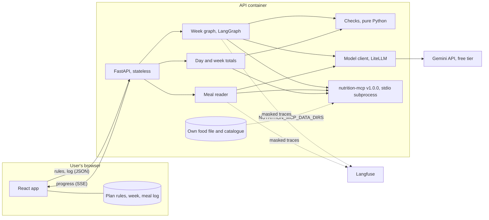
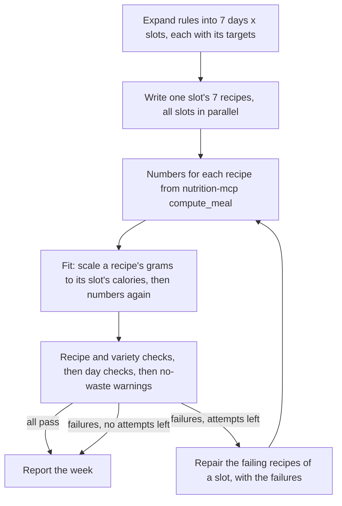

# Architecture

Status: agreed at kickoff on 2026-10-21, and brought in line with the code when the recipe pipeline was finished, on 2026-10-24. What the system must do is in [requirements.md](requirements.md); why it is built this way is in [case-study.md](case-study.md).

Built so far: the week graph, the checks, the HTTP API for writing and replacing a week, and a command line. The meal reader, the day and week totals, tracing, the frontend, the evals and the deployed demo are still to come, and the sections on them say so.

## Overview

The browser holds everything about the user. Each request sends the plan rules (and, for summaries, the log) to a stateless API. The model writes recipes and reads typed meals; nutrition-mcp supplies every nutrition number; plain Python decides whether each recipe and day passes. Nothing about the user is written to disk on the server.

## Modules (`src/meal_planner/`)

| Module | Does |
|---|---|
| `rules.py` | Pydantic models for the plan rules (day types, targets, slots, gear, food rules, shopping days) and the JSON Schema export |
| `catalogue.py` | Loads `data/catalogue.yaml`, the ingredients the writer may use, with allergen groups, pack size and shelf life. Checks every id against nutrition-mcp at startup and keeps each food's nutrients per 100 g from the same call |
| `nutrition.py` | The nutrition-mcp client: one MCP session over stdio, typed wrappers for `search_food`, `get_nutrition` and `compute_meal`, timeouts and error mapping |
| `llm.py` | The model client: model id from config, timeouts, retries with backoff, structured output into Pydantic models, and a log line with tokens, latency and cost for every call. A reply that cannot be used comes back with an error code, never as an exception. Also the fake, recorder and replayer that tests and the smoke eval use |
| `log.py` | JSON log lines on stderr that carry only an allowlist of fields (task, model, tokens, latency, cost, error, error type) and the request id, so no rule or typed text can reach a log |
| `recipes.py` | The models a recipe passes through: what the writer returns (`DraftRecipe`, `SlotDraft`), a recipe with its numbers and failures (`CheckedRecipe`), and a day's totals and failures (`DayReport`) |
| `checks.py` | Pure functions, one per hard check. Each returns pass or fail and a reason the model can act on ("protein 31 g, slot needs at least 36 g") |
| `portions.py` | Fits a recipe's grams to its slot's calories: the scale factor and the scaled draft. Arithmetic on grams only |
| `week.py` | The LangGraph graph that writes, checks and repairs a week, and `run_week` and `replace_recipe`, which run it |
| `week_events.py` | The events the graph streams to the client and the `WeekResult` that the last one carries |
| `week_prompts.py` | The writer and repair prompts: the system prompt with the catalogue filled in, and the user message built from the slot, the failures and the summaries of the slot's other recipes. String building only; it makes no model call |
| `prompts/` | The two system prompts as Markdown (`writer.md`, `repair.md`), with a placeholder for the catalogue |
| `startup.py` | What has to be true before the app answers: LangSmith tracing off, the model's key set, nutrition-mcp running, the catalogue loaded against it. Each way it fails ends in one line saying why. Shared by the API and the command line |
| `problems.py` | Invalid input in one form for the API and the command line: where it is and what is wrong. The rejected value is dropped from validation errors, because it is the user's rules, and nothing is logged. A few messages name an id so it can be fixed, such as an unknown liked or excluded food, an undefined day type or a slot the plan lacks |
| `middleware.py` | The request id, the body size limit and the rate limit, as plain ASGI middleware. Starlette's `BaseHTTPMiddleware` buffers around streams, and the week is a stream |
| `api.py` | FastAPI routes, server-sent events and CORS |
| `cli.py` | `meal-planner week <rules.json>`: the same graph without the web server, with progress on stderr and the week as JSON |
| `config.py` | Settings from environment variables (`pydantic-settings`) |

Not built yet: `reader.py` (turns a typed meal into foods and amounts), `summary.py` (day and week totals against targets) and `tracing.py` (Langfuse setup and the masking of user content). The frontend will live in `frontend/` (React, Vite, TypeScript), store the rules, the week and the log in the browser, and only display numbers the API returns.

## Writing a week

1. **Expand (code).** The rules become one entry per day and slot, each with its calorie and protein share of that day type's targets, its style, its time limits and the food rules.
2. **Write (model).** One call per slot writes that slot's 7 recipes together, so the model can see its own recipes and keep them different. The slots run in parallel, with at most `MEAL_PLANNER_MAX_CONCURRENT_MODEL_CALLS` model calls (default 4) in flight at once, so a free-tier rate limit is not hit by every slot together. The call gets the slot's targets, the rules, the cuisines to draw on and the catalogue as a list of ids and names, and returns recipes as structured output with ingredient ids and grams. Liked foods that the plan's diet, allergens or excluded foods rule out are not listed to it, and the instruction not to repeat a cuisine on neighbouring days is in the prompt only when the plan lists more than one cuisine. With `MEAL_PLANNER_WRITER_NUTRIENT_HINTS` on (the default), each catalogue line also carries the food's calories, protein, saturated fat, fibre and sodium per 100 g from nutrition-mcp, and each day's target adds the slot's share of that day type's saturated-fat cap, fibre floor and extra targets (caps rounded down, floors up). The prompt says the grams are the weight of the ingredient as listed, that the slot's style is binding, and that the steps name ingredients without amounts (code may change them). The writer is never asked for nutrition numbers, and none it writes is used: a figure in its text fails the recipe (step 5).
3. **Numbers (nutrition-mcp).** `compute_meal` gives each recipe's nutrients and glycemic load. A recipe with an ingredient id outside the catalogue is not sent; the catalogue check fails it. If nutrition-mcp cannot be reached, it is asked once more; if it still cannot be, the recipe has no numbers and is marked `nutrition_unavailable`. If it answers but refuses the recipe, or sends a result that cannot be read, the recipe has no numbers and is marked `nutrition_failed` (see Errors).
4. **Fit (code).** With `MEAL_PLANNER_FIT_PORTIONS` on (the default), a recipe written or repaired in this run whose calories are fully known and outside the slot's band has every gram multiplied by one factor, the slot's calories over the recipe's, rounded to whole grams (at least 1 g). The scaled recipe goes back to nutrition-mcp for its numbers, so no nutrient is multiplied in code. The factor must be within `MEAL_PLANNER_PORTION_SCALE_MIN` and `MEAL_PLANNER_PORTION_SCALE_MAX` (0.5 and 2.0), and no ingredient may pass 1000 g; otherwise the recipe is left to fail the slot check and go to repair. Fitting is not an attempt, and the recipes a replacement keeps are never fitted. The recipe records its factor as `portion_scale`. If nutrition-mcp cannot work out the scaled recipe, the recipe stays as the writer gave it, with its first numbers.
5. **Check (code).** Each recipe is checked for its ingredient ids and the plan's food rules (diet, excluded foods, allergens), its slot targets, its gear, its minutes (each within the slot's limit, and the active time no more than the total) and its text. A title, step, store, swap or fits line that names a nutrition figure, meaning a number next to a word such as calories, protein, fat, fibre, sugar, sodium or salt in either order, fails as `model_figure` and quotes what it says. Variety is checked within each slot: the same title, mostly the same ingredients, a cuisine outside the plan's list, or, when the plan lists more than one cuisine, the same cuisine on neighbouring days. A clash is blamed on one of the two recipes: first a recipe this run may rewrite over one it may not, then the one written in the latest round, then the later day. That way a recipe that already passed is not rewritten because another one changed. Every day's totals are worked out against its day type (daily targets, caps and floors). When a day misses a target and all its slots are there, the failure goes to the recipe that most explains the miss, once per failed check, and only if none of that day's recipes this run may rewrite fails a check of its own. The no-waste check runs on the whole week. Its findings are warnings (`no_waste` in the result): no one recipe is to blame, so nothing is repaired for them.
6. **Repair (model).** One call per slot rewrites only that slot's failing recipes. It gets the exact failures and short summaries of the slot's other recipes, so a fix doesn't break variety. A recipe is rewritten at most 3 times (`MEAL_PLANNER_MAX_REPAIR_ATTEMPTS`), so it is tried at most 4 times with the first writing. Output that doesn't parse, or has the wrong recipes for the days asked, counts as a failed attempt for the whole slot and the next call is told why; if the slot has no recipes yet it is written again. A recipe marked `nutrition_unavailable` is left out of repair, because the writer cannot fix that. A call that gets no reply at all ends repair for that slot (see Errors).
7. **Report (code).** Every recipe goes out with its numbers, its check results and how many times it was tried. A recipe that still fails says what it misses. A recipe that could not be written is listed with the reason. The week also carries the model calls made, the tokens used and, when LiteLLM has a price for the model, the cost.

A week therefore takes one writing call per slot (4 for a four-slot plan) plus at most 3 repair calls per slot. That keeps it inside free-tier quotas and makes the cost per week predictable. Fitting adds `compute_meal` calls (one more for each scaled recipe) and no model calls. Why it is done in code is in [ADR 0005](decisions/0005-code-fits-portions.md).

**Replacing one recipe** runs the same graph for a single day and slot, with the rest of the week passed in for the variety and day checks. The other recipes are never changed, and their grams and numbers are not sent to the model. Their one-line summaries (day, title, cuisine and ingredient ids) for the same slot are, so the writer can stay different from them. The old recipe leaves the week before the new one is checked, and stays if no new one could be written. Anything the new recipe clashes with, such as a dish or cuisine of a later day, or a day total that is out of range, is the new recipe's to fix: the recipes that stay are never blamed or rewritten.

**Why a graph of separate steps instead of one prompt with tools:** the model is good at combining ingredients and flavours and unreliable at arithmetic and rule-following, which nutrition-mcp's grounding run measured. Splitting the work gives each part to whichever side does it reliably, lets the slots run in parallel, and keeps repair targeted and bounded. The single-call baseline in the eval measures whether the extra steps are worth their cost.

## Reading a typed meal

Not built yet.

1. **Extract (model).** The typed text becomes a list of items as the user wrote them: a food name, an amount and a unit ("2", "roti"; "1", "katori", "dal"). The text is passed as data in its own field, never as instructions.
2. **Match (nutrition-mcp).** Each name goes to `search_food`. A clear top match is taken. When several are close, the model picks one of nutrition-mcp's results, never a free-form id. With no result, the item is marked missing.
3. **Amount.** A unit nutrition-mcp accepts for that food is passed through. Otherwise the catalogue's grams per measure turn it into grams ("2 eggs" becomes 100 g). A unit neither knows comes back to the user with the valid ones.
4. **Numbers.** `compute_meal` gives the totals. The response lists each item, its match and any missing foods, and the user confirms or edits before the browser saves it.

## Day and week totals

Not built yet.

The log holds, for each planned meal, its status and its items as food ids, amounts and units. A summary request sends the log and the rules; the server recomputes each meal with `compute_meal`, adds up each day, and compares the totals with the targets using the same functions as the day checks. A meal's glycemic load is shown only when every item in it has one.

## API

The API keeps no state. Four routes:

| Route | Does |
|---|---|
| `POST /v1/week` | Takes the plan rules as JSON and streams the week it writes |
| `POST /v1/week/replace` | Takes the rules, the week's recipes and the day and slot to write again, and streams the week with that recipe replaced |
| `GET /v1/catalogue` | Lists the ingredients a plan form can offer (id, name, category) for a `diet` and the allergens to leave out (`exclude_allergens`, repeatable) |
| `GET /healthz` | Returns `{"status": "ok"}` |

Everything that can refuse a request is checked before the stream starts, so a refusal is a status code and not a stream that fails: the body is validated, every food the rules name is looked up in the catalogue, and nutrition-mcp has to answer (a small search for a new week, the kept recipes' numbers for a replacement; see Errors).

**The stream.** A week is several model calls, so it goes out as server-sent events and the browser can show each slot as it is written and checked. An event is named by its kind and its data is JSON that repeats the kind:

- `slot_started`: a model call to write a slot's recipes has begun.
- `slot_written`: a model reply, to a writing or a repair call, had the recipes asked for. They are not checked yet.
- `recipe_checked`: a recipe was checked after it was written or rewritten, or its failures changed, with the failures.
- `repair_started`: a model call to rewrite a slot's failing recipes has begun.
- `slot_failed`: a model call gave nothing usable. `final` says whether the slot will be tried again.
- `week_done`: the last event of every run, also when slots could not be written. It carries the week: each recipe with its numbers, failures, attempts and `portion_scale`, each day's totals and failures, the no-waste warnings, the recipes that could not be written, and the model calls, tokens and cost.
- `error`: sent instead of `week_done` when the run fails after the status line has gone out.

**What replace carries.** Each recipe of the week is sent as the model wrote it (`draft`), under its day and slot, with the number of times it has been tried. There is no field for numbers or failures, and unknown fields are rejected. The server rebuilds the slot targets from the rules and works every kept recipe's numbers out again with nutrition-mcp, because anything the browser sends back could have been changed, and the new recipe is checked against that week. A slot the plan doesn't have, a recipe listed twice and a recipe filed under the wrong day are each a 422. A week has at most 56 recipes: 7 days and at most 8 slots.

**Limits.**
- Bodies: 64 KB, and 128 KB for replace because it carries the rest of the week (`MEAL_PLANNER_MAX_BODY_BYTES`, `MEAL_PLANNER_MAX_REPLACE_BODY_BYTES`). A larger one is a 413, refused at once when its declared length is over the limit and otherwise as its bytes are read.
- Rate: each client address may make 10 requests a minute to the `/v1/` routes (`MEAL_PLANNER_RATE_LIMIT_PER_MINUTE`). Past that is a 429 with `Retry-After`. The count is in memory, per process.
- CORS: headers are added only for the origins in `MEAL_PLANNER_CORS_ORIGINS`, and by default there are none.

**Request id.** Every response, refusals included, carries an `X-Request-ID` header, and every log line of that request carries the same id. The one exception is a CORS preflight, which the CORS middleware answers before the request id is made.

**No access log.** uvicorn's access log is off (`make run` passes `--no-access-log`). Its line includes the query string, which for `/v1/catalogue` holds a plan's diet and allergens, and logs never hold a plan's rules. A deployment has to switch it off too.

## Data

| Path | Holds |
|---|---|
| `data/foods/` | This project's food file in nutrition-mcp's custom-dataset format: `sources.yaml` (USDA FoodData Central, public domain) and `ingredients.csv` (16 nutrients per 100 g, with an empty cell for a value USDA doesn't report). Loaded by nutrition-mcp through `NUTRITION_MCP_DATA_DIRS` |
| `data/catalogue.yaml` | Every ingredient the writer may use, from nutrition-mcp's bundled data and the food file: id, display name, shop category, allergen groups, typical pack size, days it keeps once opened |
| `scripts/build_foods.py` | Builds `data/foods/ingredients.csv` from a reviewed list of FoodData Central records in `data_build/food_map.csv`, and lists every FDC portion of them in `data_build/portions_review.csv` for checking the catalogue's measures (needs a free `USDA_FDC_API_KEY` for records not cached yet) |
| `evals/datasets/` | Synthetic plans and labelled typed meals (not added yet) |

USDA data has no glycemic index, so a meal with any ingredient from the food file has no glycemic load. The day view says so instead of estimating it. How each record was chosen and mapped is in [data.md](data.md).

## Privacy

- The API keeps no state. Rules and logs arrive with each request and are dropped after the response.
- Logs record ids, counts, tokens, latency and cost, never the rules or typed text.
- Traces will mask the rules and typed text before they leave the process. Until tracing is built, startup refuses to run with LangSmith tracing on (see Errors).
- Export and import in the browser is the only backup. Clearing the browser's storage loses the data, and the UI says so.

## Errors

Startup problems stop the app with one line that says why. A request that cannot be served gets a status code before any stream starts. After that, trouble shows up in the stream or in the week's result.

| Failure | Behaviour |
|---|---|
| The model's key is not set, or LangSmith tracing is switched on | Startup stops. The line names the variables to set, or the tracing variable to unset, because LangGraph would send the plan rules to LangSmith. Both are checked before nutrition-mcp starts |
| nutrition-mcp doesn't start, or stops answering or sends an answer that cannot be read while the catalogue loads | Startup stops with nutrition-mcp's reason |
| A catalogue id unknown to nutrition-mcp | Startup stops and names every such id |
| Invalid rules, or a liked or excluded food that is not in the catalogue | 422 with a list of where and what. The rejected value is dropped from validation errors and nothing is logged; a few messages name an id so it can be fixed, such as an unknown liked or excluded food or an undefined day type |
| A body over the limit, or too many requests | 413, or 429 with `Retry-After` (see API) |
| nutrition-mcp cannot be reached before a run starts | 503 naming the step: `nutrition` for a new week, which first asks it a small question so that no model call is spent on a server that is down, and `recompute` for a replacement, whose kept recipes need their numbers worked out. For a replacement, nutrition-mcp is asked twice before this, and its refusing one recipe is not a 503: that recipe is marked `nutrition_failed` |
| nutrition-mcp cannot be reached in the middle of a run | It is asked once more. If that fails too, the recipe has no numbers and a `nutrition_unavailable` failure, is not sent back to the writer, which cannot fix that, and is reported failing. The run goes on. The recipe's day cannot pass, because a recipe with no numbers counts as missing every nutrient. A scaled recipe whose numbers cannot be had keeps the writer's grams and its first numbers |
| nutrition-mcp refuses a recipe, or sends a result that cannot be read | The recipe has no numbers and a `nutrition_failed` failure that carries the reason, which for a refusal usually names the food. It goes back to the writer like any failing recipe, and if it still fails at the end it is reported with that failure. The run goes on |
| A model call gets no reply: a timeout, a rate limit, a server error, another refusal such as a bad key, or an unexpected exception | A timeout, rate limit or server error is tried 3 times in all, waiting 1 s and then 2 s between tries. When the tries are used up, or at once for any other refusal, the call counts as having no reply. A writing call: the slot's recipes are listed as not written, with the error code, a final `slot_failed` event goes out, and the other slots go on. A replacement keeps the old recipe. A repair call: the slot's failing recipes stay as they were, with their failures and one more attempt counted, and the slot is not repaired again. An exception counts as `model_error` for its slot only, and the log line holds only its class, so the rest of the week goes on |
| Model output that isn't valid JSON, doesn't fit the schema, or has the wrong recipes for the days asked | A failed attempt for that slot, and the next call is told why. After the last attempt the slot ends up as in the row above |
| The run fails after the stream has started | The status line has gone out, so the stream ends with one `error` event that names the step (`week` or `replace`) and says only that the run stopped. It holds no text from the exception, which can quote the request, and the log line holds only the exception's class |
| Anything unhandled before the stream starts | 500 with `internal error`; only the exception's class is logged |
| The client goes away during a run | The run is cancelled, so its model calls stop |

## Security

- Typed meals and free-text fields in the rules (liked foods, cuisine names) are untrusted. They go to the model as delimited data and model output is parsed into schemas. The model has no tools: code calls nutrition-mcp's read-only ones.
- A rate limit on the `/v1/` routes, a size limit on every request body, and CORS headers only for the origins in `MEAL_PLANNER_CORS_ORIGINS` (see API).
- Keys come from the environment; gitleaks runs in pre-commit and CI.

## Evaluation design

Not built yet: `make eval` and `make eval-smoke` are placeholders.

- **Recipe eval.** For each of the 20 synthetic plans, the pipeline and the single-call baseline each write a week, and the same check functions score both. Results go to `evals/results/` with the date, model, commit, dataset version and cost, and `summary.md` puts the headline (share of recipes passing every hard check) in its first row.
- **Reading eval.** About 50 typed meals with labelled foods and grams. Food match is scored per item, and calorie error is computed against the labelled foods' numbers from nutrition-mcp.
- **Smoke eval.** Recorded model responses for a fixed slice are replayed through the real checks and nutrition-mcp, so CI needs no key and gives the same result on every run.

## Deployment

Today only the local run and the image build exist. The rest is the plan.

- **Local:** `make run` starts the API on 127.0.0.1:8000, which starts nutrition-mcp. The Vite dev server joins it once the frontend exists. `meal-planner week <rules.json>` runs the same graph without the server.
- **Image:** the Dockerfile installs the app and nutrition-mcp (from its `v1.0.0` tag, through the lock file, so nothing is fetched at runtime), and CI builds it. Its entrypoint is still the `meal-planner` command. Running the API from it, with a smoke request against the container in CI, is still to come.
- **Public demo (after a yes):** the API on a free Hugging Face Docker Space with its own low-quota key, rate limits and a spend cap; the frontend on GitHub Pages.

## Decided at kickoff

- The user brings a plan; the system writes recipes for it and tracks against it ([0001](decisions/0001-follow-an-existing-plan.md)).
- The model writes, code checks every number and rule, and failures go back with reasons ([0002](decisions/0002-model-writes-code-checks.md)).
- New foods reach nutrition-mcp through its custom-dataset folder, not through changes to it ([0003](decisions/0003-foods-through-nutrition-mcp-datasets.md)).
- The user's data stays in the browser, and the API is stateless ([0004](decisions/0004-user-data-in-the-browser.md)).

## Decided since

- Code fits a recipe's portions to its slot's calories, and the writer is shown nutrition per 100 g and the day's limits, each behind a switch so the eval can measure it ([0005](decisions/0005-code-fits-portions.md)).
