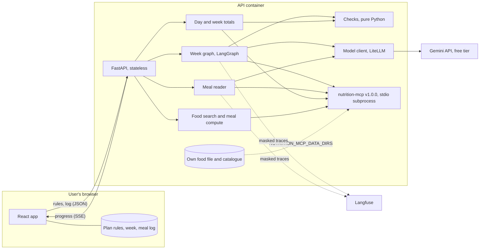
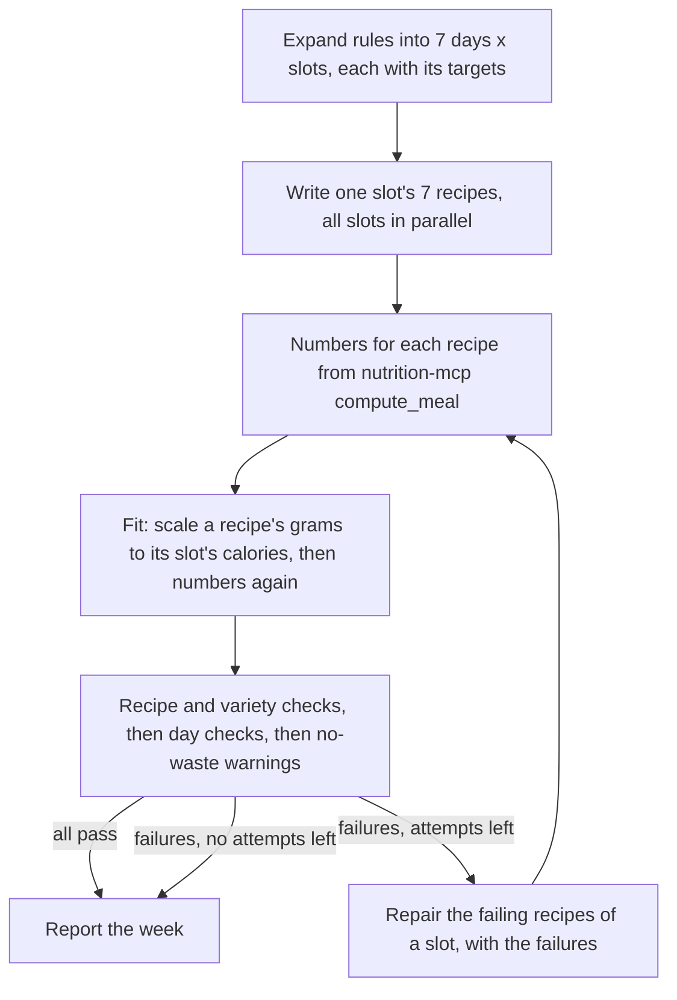
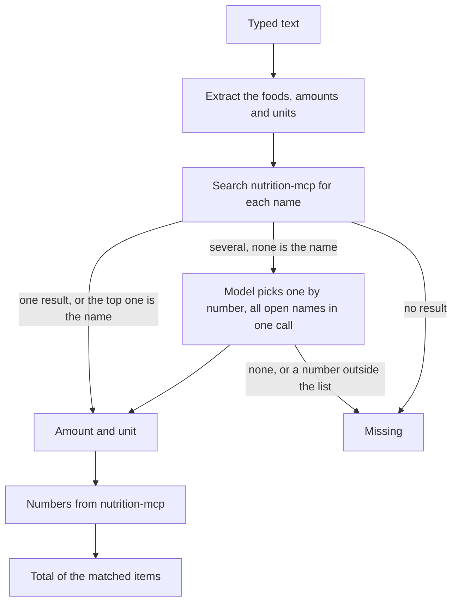

# Architecture

Status: agreed at kickoff on 2026-10-21, and brought in line with the code when the recipe pipeline was finished, on 2026-10-24, again when the meal reader and the day and week totals were added, on 2026-10-25, after their review, on 2026-10-26, when tracing was added, on 2026-10-28, after the milestone 4 review, when the food search and compute routes were added, on 2026-10-29, when the frontend's base was added, on 2026-11-04, when its plan, week and recipe screens were added, on 2026-11-05, and when its log and summary screens were added, on 2026-11-06. What the system must do is in [requirements.md](requirements.md); why it is built this way is in [case-study.md](case-study.md).

Built so far: the week graph, the checks, the meal reader, the day and week totals, the HTTP API for writing and replacing a week, reading a typed meal, searching foods, working out a meal as it is edited and summarising a log, a command line with `week`, `read` and `summary`, the eval runner with its first full runs, masked tracing to Langfuse, and the frontend's base (its design system, browser storage with export and import, and a typed client for the API) with its plan form, week, recipe, log and summary screens. The deployed demo is still to come, and the section on it says so.

## Overview

The browser holds everything about the user. Each request sends the plan rules (and, for summaries, the log) to a stateless API. The model writes recipes and reads typed meals; nutrition-mcp supplies every nutrition number; plain Python decides whether each recipe and day passes. Nothing about the user is written to disk on the server.

## Modules (`src/meal_planner/`)

| Module | Does |
|---|---|
| `rules.py` | Pydantic models for the plan rules (day types, targets, slots, gear, food rules, shopping days) and the JSON Schema export. A day type's extra targets are for nutrients it has no field for: one that repeats calories, protein, carbohydrate, fat, saturated fat or fibre, or names a nutrient twice, is refused with the field named |
| `catalogue.py` | Loads `data/catalogue.yaml`, the ingredients the writer may use, with allergen groups, pack size, shelf life and grams per household measure. Checks every id against nutrition-mcp at startup and keeps each food's nutrients per 100 g, and the grams in one of each unit nutrition-mcp has for it, from the same call. `unit_grams` gives the grams for each of a food's `valid_units`. `meal_item` settles the unit of a food eaten for the reader and the summary alike (see Reading a typed meal, step 4) |
| `nutrition.py` | The nutrition-mcp client: one MCP session over stdio, typed wrappers for `search_food`, `get_nutrition` and `compute_meal`, timeouts and error mapping |
| `llm.py` | The model client: model id from config, timeouts, retries that back off with jitter and follow a provider's Retry-After, structured output into Pydantic models, and a log line with tokens, latency and cost for every call. A reply that cannot be used comes back with an error code, never as an exception. Also the fake, recorder and replayer that tests and the smoke eval use |
| `log.py` | JSON log lines on stderr that carry only an allowlist of fields (task, model, tokens, latency, cost, error, error type, recount) and the request id, so no rule or typed text can reach a log |
| `recipes.py` | The models a recipe passes through: what the writer returns (`DraftRecipe`, `SlotDraft`), a recipe with its numbers, failures and household measures (`CheckedRecipe`, `HouseholdMeasure`), and a day's totals and failures (`DayReport`) |
| `checks.py` | Pure functions, one per hard check. Each returns pass or fail and a reason the model can act on ("protein 31 g, slot needs at least 36 g"). A number in a reason is whole when whole units are within 2% of it and has one or two decimals when they are not, so a limit of 2.4 ug is not shown as 3; rounding goes up for a floor and down for a cap. A list of foods with no value for a nutrient names foods only, as a person reads them ("mustard oil"), also for a recipe nutrition-mcp could not work out, which lacks all its ingredients. `add_up_meals` adds up a day's meals for both the day checks and the summaries |
| `portions.py` | Fits a recipe's grams to its slot's calories: the scale factor and the scaled draft. Arithmetic on grams only |
| `measures.py` | The household measure beside each ingredient's grams, and the rule that picks it (see Household measures) |
| `week.py` | The LangGraph graph that writes, checks and repairs a week, and `run_week` and `replace_recipe`, which run it |
| `week_events.py` | The events the graph streams to the client, the `WeekResult` that the last one carries, and `StreamError`, the event the API sends instead when a run fails after its stream has started |
| `week_prompts.py` | The writer and repair prompts: the system prompt with the catalogue filled in, and the user message built from the slot, the failures and the summaries of the slot's other recipes. String building only; it makes no model call |
| `data_block.py` | What every prompt shares: loading a prompt file, and quoting text into the data block so that it cannot close it. The writer, the repair prompt, the eval's baseline and the reader use it |
| `summary.py` | The meal log (`MealLog`, its entries and foods), the export file (`Export`), `meal_of`, which works one meal out with nutrition-mcp, and `summarise`, which works each eaten meal out with nutrition-mcp and holds each date's total to the targets of its day type (see Day and week totals) |
| `reader.py` | Turns a typed meal into nutrition-mcp foods, amounts and numbers (see Reading a typed meal). One model call to list the foods and, when nutrition-mcp's search leaves names open, one more to pick among its options for all of them. Code decides whether each amount is usable (the model's number must be the one its words give), settles the unit and sets the status of each item, and nutrition-mcp gives the numbers |
| `foods.py` | What the swap screen needs (see Changing a matched food): `food_options`, which searches nutrition-mcp for a name and returns each food with the units an amount can use for it, read through the catalogue. A meal is worked out by `summary.meal_of`, the function the summary uses |
| `prompts/` | The system prompts as Markdown: `writer.md` and `repair.md`, with a placeholder for the catalogue, and `reader.md` and `choose_food.md` for the meal reader |
| `startup.py` | What has to be true before the app answers: LangSmith tracing off, the model's key set (unless the work makes no model call, as with `meal-planner summary`), nutrition-mcp running, the catalogue loaded against it. Each way it fails ends in one line saying why. It also turns tracing on when the Langfuse keys are set, except for `meal-planner summary` or an eval run, which are never traced, and sends what is left when it stops. Shared by the API, the command line and the eval runner |
| `tracing.py` | Langfuse tracing (see Tracing): `setup_tracing`, `mask` and its list of id fields, the spans the graph and the reader open, and `TracedModel`, which records each model call as a generation |
| `problems.py` | Invalid input in one form for the API and the command line: where it is and what is wrong. The location of an unknown liked or excluded food comes from the catalogue check as data, not from the wording of its message. The rejected value is dropped from validation errors, because it is the user's rules, and nothing is logged. A few messages name an id so it can be fixed, such as an unknown liked or excluded food, an undefined day type or a slot the plan lacks. A typed meal that is blank is said to be blank, and one that is too long gives its length and the limit. Neither message holds any of the text |
| `middleware.py` | The request id, the body size limit and the rate limit, as plain ASGI middleware. Starlette's `BaseHTTPMiddleware` buffers around streams, and the week is a stream |
| `api.py` | FastAPI routes, server-sent events and CORS |
| `cli.py` | `meal-planner week <rules.json>`: the same graph without the web server, with progress on stderr (the `week_done` line names each day's failing and unsettled checks) and the week as JSON. `meal-planner read "<text>"`: reads a typed meal and prints the result as JSON. `meal-planner summary <rules.json> <log.json>`: adds up a meal log against the plan and prints the week summary as JSON |
| `config.py` | Settings from environment variables (`pydantic-settings`), the Langfuse ones under Langfuse's own names, and the LangSmith variables startup refuses |

## Frontend (`frontend/`)

A React app built with Vite, in TypeScript with `strict` on. It keeps the rules, the week and the log in the browser and shows only numbers the API returns. Its look comes from the design system in `design-system/meal-planner/MASTER.md`, whose tokens are in `src/styles/tokens.css`. The screen is the part of the address after `#/` (`#/plan`, `#/week`, `#/recipe/<day>/<meal>`, `#/recipes`, `#/log` and `#/log/<date>`, `#/summary` and `#/summary/<date>`), so the built app is static files that any host can serve and a reload keeps the screen. The navigation names the plan, the week, the log and the summary.

| File | Does |
|---|---|
| `src/types.ts` | The types of everything the app keeps or the API takes and returns, generated from `schemas/` by `scripts/generate-types.ts` (`npm run types`), never written by hand. The schema files share definitions, so they are merged first and a name defined two ways stops the script. CI fails when the file is out of date with `schemas/`, and the check job fails when `schemas/` is out of date with the models |
| `src/storage.ts` | `loadState` and `saveState` keep the state in IndexedDB, or in localStorage when the browser has no IndexedDB or `open` throws at once (as it does where site data is blocked, so nothing can have been saved there). Every save to IndexedDB removes the localStorage copy, so a copy found there is the newer one and is read first. An open request that fails, a read that fails, or a database another tab has upgraded is `SavedDataUnreadable`: IndexedDB may hold a plan it cannot read now, so the load is refused rather than started empty, and a save writes nothing unless the newer localStorage copy exists. A failed open is tried again on the next call. `saveState` checks the state as `loadState` will and refuses one that would not load again with `ValidationFailed`, writing nothing, so the last good state stays. When neither backend can keep anything, a save is refused with `StorageUnavailable`. `exportFile` writes the state as one file in the format of `schemas/export.json`; `importFile` checks a file before it is used (see `validate.ts`) |
| `src/validate.ts` | Checks a file, and what the browser saved, against `schemas/export.json`, then runs the checks the schema cannot express, as the server's models run them: unique day type and slot ids, a defined day type for each day, extra targets that repeat no other, slot shares that add up to 1, a skipped meal with no foods and an eaten one with some, one entry for each date and slot, at most 7 days, and each entry's slot in the plan. That last is the summary's check, not the model's: the model would accept such a file, but every summary of it would be refused, so it is refused when the file is loaded. A name, cuisine, recipe title or step that is blank once trimmed is refused too, since the server trims those before it checks their length. The schema check runs validators that `scripts/generate-validators.ts` compiles from `schemas/export.json` with Ajv ahead of time (`npm run validators`, held current by CI), so nothing is compiled in the browser and a Content-Security-Policy without `'unsafe-eval'` does not break it. `tests/unit/test_export_schemas.py` checks that the server refuses each file in `src/test/invalid-exports.json`, the cases the browser's tests refuse, so the copied checks stay in step for those cases. A file that fails is refused with `ValidationFailed`, listing each problem with its JSON Pointer, such as `/log/entries/0/items/0/food_id`. Dates and times are read as the server reads them ("08:00" is a time). A field the server has a default for is filled in when it is missing |
| `src/api.ts` | One function per route: `streamWeek` and `replaceRecipe` post the rules (and the week's drafts, without their numbers) and read the server-sent events from the response, since `EventSource` can only send a GET; each event goes to a callback and the promise resolves with the week. The stream is closed once the week arrives or the callback throws, and closing it (or aborting the call) makes the server cancel the run. A connection that drops mid-stream is a `StreamFailed` too; an abort stays an `AbortError`. A 200 whose body is not JSON is an `ApiError`. `readMeal`, `summarise`, `catalogue`, `searchFoods` and `computeMeal` are one JSON request each. A refusal is an `ApiError` with the 422's problems or the message, the request id and Retry-After; a stream that sends its `error` event or ends without the week is a `StreamFailed` naming the step. The API's address is the page's own unless `VITE_API_BASE` is set when the app is built |
| `src/App.tsx` | The shell: reads what the browser saved, keeps it while the page is open, saves each change and shows the screen the address names, with the focus on the new screen's heading. A save the browser refuses keeps the state on the page and says so with the export. When the saved state cannot be opened (`ValidationFailed` or `SavedDataUnreadable`), the storage error screen says why, offers the stored copy as a file (`readStoredText`) and only after that offers to remove it (`discardStoredText`, which removes only the copy the load refused, so an older IndexedDB state then opens); nothing is written over a stored plan before the person asks |
| `src/planForm.ts`, `src/screens/PlanForm.tsx` | The plan form edits the rules as typed text and turns them into `PlanRules` on save: its own checks first (numbers, names, slot shares that add up to 100% of the day), then `validate.ts`'s, against the rules and the meal log they will be saved with. Day types and meals get ids from their names once and keep them when renamed, so the week and the log still refer to them. Each problem shows under its field and in a list at the top that links to it; the problems of a 422 from the week's routes show the same way (`fromServer` places a check on the rules as a whole, such as `slots: ...` at `body`, at the field it names). The food lists come from the catalogue the shell holds (`src/useCatalogue.ts`). A change to a plan with a written week asks before it clears that week |
| `src/useCatalogue.ts` | The catalogue from `GET /v1/catalogue`, held by the shell for the plan form's food lists and the recipe page's steps. Every `/v1/` route shares one rate limit, so it is asked for once per page, by the first of those screens to open, and not again when a screen opens again. A list that failed is asked for again the next time a screen needs it, and the plan form can ask again on the person's say |
| `src/useWeekRun.ts`, `src/progress.ts`, `src/screens/Week.tsx` | The week screen writes a week or one recipe again over the stream: each meal's step in words in a live region ("Repairing, try 2 of 4"), a progress bar of meals written, then a table of days and meals from 1024px and one day at a time below that. A recipe that misses a check lists what it misses, a meal that could not be written says why, and a day's checks say Meets, Misses or Can't tell with their reasons. A replacement's week names only its own meal when it could not be written, so the meals the week could not write before are kept; a replacement that writes no new recipe says so and changes nothing. The run belongs to the shell, so it goes on while another screen is open; Stop aborts it, which makes the server cancel it |
| `src/screens/RecipePage.tsx` | A recipe to cook from: what it misses, the time, when to cook it, the gear, its share of the day, the grams with a household measure where there is one, the steps, with the names of the gear and foods they quote, as in the store, swap and fits lines (see Household measures), and the 16 nutrients, with "at least" and the foods with no value where a total is a lower bound, and the glycemic load or the number of ingredients that lack one. `#/recipes` lists every recipe to print. In print each recipe starts an A4 page, black on white in either theme, with the grams beside the steps and the six core numbers on one line |
| `src/mealLog.ts`, `src/dates.ts`, `src/screens/Today.tsx` | The log (`#/log`) opens on the reader's own date (`src/useToday.ts`, which moves on at midnight) and moves a day back or forward. A date's planned meals are the saved week's recipes for its weekday, as the summary maps a date to its day type. Each meal is logged with one tap: as planned (the recipe's ingredients at their final grams), a different amount (half, one and a half, or the grams of the whole meal, which scales every ingredient by that over the recipe's weight, at most 5000 g), swapped or skipped. As planned and a different amount need a written recipe that nutrition-mcp worked out, whether or not it met its checks: one with no numbers has a food the summary would refuse. Any meal can be swapped or skipped. Logging a meal again replaces its entry. The log keeps the server's rules: one entry for each date and meal, and at most 7 consecutive days. A meal that would make it longer is not saved: the screen says so, offers the export, and only once the file is saved offers to start a new log with that meal. After a save the focus goes back to the button that was pressed |
| `src/swap.ts`, `src/screens/SwapFlow.tsx` | The swap flow (see Changing a matched food). The meal reader's items are listed with a status word each: found, needs an amount, unit not known or missing. A found food is confirmed or changed; a food that needs an amount or a unit has the fields for them. The units offered are the reader's `valid_units` for the food. "Change food" searches nutrition-mcp when its form is sent, never as the person types. Confirming a changed food sends the counted foods to the compute route, and its numbers are shown beside the amount and unit the person gave. The total is the reader's, then the compute route's, for the counted foods only; a missing food is listed, left out of the total and not saved, never replaced. Saving waits, with the reason, until every found food is confirmed and none needs an amount or a unit. A read, search or compute that is refused or fails says why (a 429 says how long to wait) with a button to try again |
| `src/useSummary.ts`, `src/screens/WeekView.tsx`, `src/screens/DayView.tsx` | The summary of the log (`POST /v1/summary`), held by the shell like the catalogue: asked for when the summary (`#/summary`) or a day (`#/summary/<date>`) opens, and again only once the plan or the log has changed, so moving between them costs no request; a failed one is asked for again on the person's say or the next time a view opens. Nothing is asked for while the log is empty. The summary shows the share of planned meals eaten as planned and the days that met every target, each day linking to its view. A day shows every nutrient the plan targets, eaten against its target (whether a target is a floor or a cap is read from the rules), with Meets, Misses or Can't tell and the reasons, carbohydrate and fat as a share over or under, "at least" where a food lacks a value, and each meal's glycemic load, or "not known" with the number of items that lack one. Every number on both is the server's |
| `scripts/a11y.ts`, `pa11y.json` | The accessibility check (`npm run a11y`, a CI job): pa11y-ci with axe over the built site, each screen of `pa11y.json` at 1280 and 375px wide, in the light theme and then the dark one. Issues axe leaves to a person are warnings; any other fails it. `scripts/a11y-server.ts` serves the site and stands in for the browser's saved state and for the API routes the screens touch; the week and recipe screens open on `src/test/recorded-week.json`, which `scripts/record_week_fixture.py` streams from the API with the smoke recording's model replies and the real nutrition-mcp. The log and summary screens open on the log in `src/test/recorded-tracking.json`, and the read, search, compute and summary routes answer with the replies recorded with it by `scripts/record_tracking_fixture.py` (a typed meal from the smoke slice, so its model replies come from the smoke recording). The swap flow is checked with a read meal and a search open, and with a read the server refuses (the stub refuses one typed meal with a 429), and the different amount panel with a field error |

In development the Vite server (`make run-frontend`, on 127.0.0.1:5173) passes `/v1` calls to the API on 127.0.0.1:8000, so the browser sees one origin and the API needs no CORS setting.

## Writing a week

1. **Expand (code).** The rules become one entry per day and slot, each with its calorie and protein share of that day type's targets, its style, its time limits and the food rules.
2. **Write (model).** One call per slot writes that slot's 7 recipes together, so the model can see its own recipes and keep them different. The slots run in parallel, with at most `MEAL_PLANNER_MAX_CONCURRENT_MODEL_CALLS` model calls (default 4) in flight at once, so a free-tier rate limit is not hit by every slot together. The call gets the slot's targets, the rules, the cuisines to draw on and the catalogue as a list of ids and names, and returns recipes as structured output with ingredient ids and grams. Liked foods that the plan's diet, allergens or excluded foods rule out are not listed to it, and the instruction not to repeat a cuisine on neighbouring days is in the prompt only when the plan lists more than one cuisine. With `MEAL_PLANNER_WRITER_NUTRIENT_HINTS` on (the default), each catalogue line also carries the food's calories, protein, saturated fat, fibre and sodium per 100 g from nutrition-mcp, and each day's target adds the slot's share of that day type's saturated-fat cap, fibre floor and extra targets (caps rounded down, floors up). The prompt says the grams are the weight of the ingredient as listed, that the slot's style is binding, and that the steps name ingredients without amounts (code may change them). The writer is never asked for nutrition numbers, and none it writes is used: a figure in its text fails the recipe (step 5).
3. **Numbers (nutrition-mcp).** `compute_meal` gives each recipe's nutrients and glycemic load. A recipe with an ingredient id outside the catalogue is not sent; the catalogue check fails it. If nutrition-mcp cannot be reached, it is asked once more; if it still cannot be, the recipe has no numbers and is marked `nutrition_unavailable`. If it answers but refuses the recipe, or sends a result that cannot be read, the recipe has no numbers and is marked `nutrition_failed` (see Errors).
4. **Fit (code).** With `MEAL_PLANNER_FIT_PORTIONS` on (the default), a recipe written or repaired in this run whose calories are fully known and outside the slot's band has every gram multiplied by one factor, the slot's calories over the recipe's, rounded to whole grams (at least 1 g). The scaled recipe goes back to nutrition-mcp for its numbers, so no nutrient is multiplied in code. The factor must be within `MEAL_PLANNER_PORTION_SCALE_MIN` and `MEAL_PLANNER_PORTION_SCALE_MAX` (0.5 and 2.0), and no ingredient may pass 1000 g; otherwise the recipe is left to fail the slot check and go to repair. Fitting is not an attempt, and the recipes a replacement keeps are never fitted. The recipe records its factor as `portion_scale`. If nutrition-mcp cannot work out the scaled recipe, the recipe stays as the writer gave it, with its first numbers.
5. **Check (code).** Each recipe is checked for its ingredient ids and the plan's food rules (diet, excluded foods, allergens), its slot targets, its gear, its minutes (each within the slot's limit, and the active time no more than the total) and its text. A title, step, store, swap or fits line that names a nutrition figure, meaning a number next to a word such as calories, protein, fat, fibre, sugar, sodium or salt in either order, fails as `model_figure` and quotes what it says. Variety is checked within each slot: the same title, mostly the same ingredients, a cuisine outside the plan's list, or, when the plan lists more than one cuisine, the same cuisine on neighbouring days. A clash is blamed on one of the two recipes: first a recipe this run may rewrite over one it may not, then the one written in the latest round, then the later day. That way a recipe that already passed is not rewritten because another one changed. Every day's totals are worked out against its day type (daily targets, caps and floors). A food with no value for a nutrient in nutrition-mcp's data makes the day's total for it a lower bound, and so does a recipe nutrition-mcp could not work out, which counts as lacking every nutrient in its foods. For saturated fat there is an upper bound as well: each such food counts its total fat, since saturated fat is part of fat and can never be more (`sat_fat_ceiling`, nutrition-mcp's numbers only). A day fails a check the two bounds show it misses and passes one they show it meets. Anything else is unsettled: the missing values could put the day either side of the limit, so the check is neither a pass nor a failure, and the day reports it under `unsettled`. When a day misses a target and all its slots are there, the failure goes to the recipe that most explains the miss, once per failed check, and only if none of that day's recipes this run may rewrite fails a check of its own. An unsettled check is never blamed on a recipe, and that is a choice, not a limit. Calories, and a cap with no ceiling, cannot be settled by a rewrite short of dropping the food, since nothing bounds the missing part from above. The rest can: less of a food with no value lowers the saturated-fat ceiling, and more of what is known raises a floor's known part. Repair is not asked to: the missing value may settle the check by itself (a dal with no fibre value still has fibre, and rohu's fat is not all saturated), and chasing what the data cannot show would spend model calls. A day a rewrite could have settled is left as it is. The no-waste check runs on the whole week. Its findings are warnings (`no_waste` in the result): no one recipe is to blame, so nothing is repaired for them.
6. **Repair (model).** One call per slot rewrites only that slot's failing recipes. It gets the exact failures and short summaries of the slot's other recipes, so a fix doesn't break variety. A recipe is rewritten at most 3 times (`MEAL_PLANNER_MAX_REPAIR_ATTEMPTS`), so it is tried at most 4 times with the first writing. Output that doesn't parse, or has the wrong recipes for the days asked, counts as a failed attempt for the whole slot and the next call is told why; if the slot has no recipes yet it is written again. A recipe marked `nutrition_unavailable` is left out of repair, because the writer cannot fix that. A call that gets no reply at all ends repair for that slot (see Errors).
7. **Report (code).** Every recipe goes out with its numbers, its check results, how many times it was tried and a household measure for each ingredient, worked out in code from its final grams (see Household measures), and every day with its totals, its failures and its unsettled checks. A recipe that still fails says what it misses. A recipe that could not be written is listed with the reason. The week also carries the model calls made, the tokens used and, when LiteLLM has a price for the model, the cost.

A week therefore takes one writing call per slot (4 for a four-slot plan) plus at most 3 repair calls per slot. That keeps it inside free-tier quotas and makes the cost per week predictable. Fitting adds `compute_meal` calls (one more for each scaled recipe) and no model calls. Why it is done in code is in [ADR 0005](decisions/0005-code-fits-portions.md).

**Replacing one recipe** runs the same graph for a single day and slot, with the rest of the week passed in for the variety and day checks. The other recipes are never changed, and their grams and numbers are not sent to the model. Their one-line summaries (day, title, cuisine and ingredient ids) for the same slot are, so the writer can stay different from them. The old recipe leaves the week before the new one is checked, and stays if no new one could be written. Anything the new recipe clashes with, such as a dish or cuisine of a later day, or a day total that is out of range, is the new recipe's to fix: the recipes that stay are never blamed or rewritten.

**Why a graph of separate steps instead of one prompt with tools:** the model is good at combining ingredients and flavours and unreliable at arithmetic and rule-following, which nutrition-mcp's grounding run measured. Splitting the work gives each part to whichever side does it reliably, lets the slots run in parallel, and keeps repair targeted and bounded. The single-call baseline in the eval measures whether the extra steps are worth their cost.

## Household measures

Each ingredient of a recipe in the week carries an optional household measure beside its grams ("182 g, 1½ pieces"). It is worked out in code when the week is reported (step 7 above), from the grams each recipe leaves with: the fitted grams for a recipe that was fitted, the grams as written for one that was not, and for a replacement, the grams of the recipes it keeps as well. No call is made for it, and it is never in a prompt, so the writer and repair prompts are the same with it or without it.

- **Units and their grams.** The units are the food's `valid_units`, in that order: nutrition-mcp's units for the food (its own measures, the default katori for a dish served by the bowl, volume units for a liquid), then the catalogue's `measures`. nutrition-mcp's grams in one of each are kept on the catalogue item when the catalogue loads; the catalogue's come from `data/catalogue.yaml`. A food the catalogue lacks has no units.
- **The rule** (`measures.py`). g and ml are never a measure, since the grams are already shown. A unit fits when its rounded amount is above 0 and comes, in grams, within 15% of the ingredient's grams. A counted unit rounds to the nearest half and any other unit to the nearest quarter, a tie going up. The counted units are the piece-like ones in the data: piece and roti in nutrition-mcp's, and piece, clove, leaf and slice in the catalogue's. Of the units that fit, the measure is the one with the most grams in one whose amount is at least a half; when no unit that fits reaches a half, it is the one with the fewest grams in one. Units with the same grams in one keep the `valid_units` order. So 200 g of milk is ¾ glass rather than 13 tbsp, 4 g of oil is ¾ tsp rather than ¼ tbsp, and 140 g of mushrooms is 2 cups rather than 8 pieces. When no unit fits there is no measure, never a guess, so 1 cup never stands for half a cup.
- **In the file.** Each recipe's `measures` holds one measure or null per ingredient, in the draft's order. The field is optional in the export file, so a file saved before it loads with none, and the export `version` stays 1. The replace request has no field for it: the server works it out again.
- **On screen.** The recipe page and its print show the measure after the grams in muted text, and the grams alone where there is none. The week screen lists no ingredients, so it shows no measures. The words are the page's own: a quarter, half or three quarters as a fraction (¼, ½, ¾), and a unit in the plural above one where the data's unit has a plural (tsp and tbsp stay as they are).

**Names in the writer's text.** The writer's steps and its store, swap and fits lines often quote ids ("cook the brown_rice in a pressure_cooker", "use chana_dal instead of moong_dal"). The recipe page, and its print, show a name in place of each id of more than one word that this text quotes, whole words only, in lower case except at the start of the text or for a name that starts with a proper adjective (Greek, French): "cook the brown rice in a pressure cooker", "top with Greek yogurt (low fat)". A gear id shows the gear's label from `GEAR` in `src/words.ts`, the words the recipe's Gear row shows; a catalogue id shows the catalogue's name. An id of one word ("curd", "kadhai") is already a word of the text and stays as written. Once the catalogue has loaded, the ingredient table uses its names too, so the page names each food one way; until then the table has nutrition-mcp's names. It is display only: the week, the export file and the replace request keep the text as the model wrote it. The catalogue's names come from `GET /v1/catalogue`, which the shell asks for once per page, by whichever of the plan form and the recipe page opens first (`src/useCatalogue.ts`). Until it has loaded, or if it could not be loaded, catalogue ids show as written; gear labels need no request, so gear ids are named from the start.

## Reading a typed meal

1. **Extract (model).** One call lists the foods the text names, up to 20, each with a name, an amount, a unit and the words the person used for the amount (`amount_text`). The text goes in as a JSON string inside a delimited data block, with angle brackets escaped so that it cannot close the block, and the prompt says it is data and never instructions. The reply has no field for a nutrition figure, and anything extra in it is ignored. An item with no name is dropped.
2. **Match (nutrition-mcp).** Each name goes to `search_food`, for up to 5 results. The top result is taken when it is the only one, or when the name typed is its name, one of its aliases or its id, compared as nutrition-mcp's search spells words ("chapaati" is "chapati"). The names this leaves open go to one more model call together: each name with its numbered results, and the reply picks a result by its number, or none, for each name by the name's number. A name typed twice is asked about once. The call is shown the names and the results only, never the rest of the text, and it never writes an id. A name with no result, a name nutrition-mcp cannot search for (no letter or digit in it, or over 100 characters), a pick of `null`, a pick outside the list, no pick and two picks that disagree all leave the item `missing`.
3. **Amount (code).** The model's number is used only when its words for the amount (`amount_text`), with case and spaces folded, are in the text the person typed, and on their own there rather than inside a longer number or word ("2" in "12", "one" in "honey"), when they are neither vague nor a range, and when they give that number. Words the model made up ("roti and dal" read as amount 1 with the words "1"), blank amount text, a vague word (some, a little, a bit, few, handful, lots, several, many, plenty) or a range (2-3, 2 to 3, 2 or 3, two or three) makes the item `needs_amount` whatever number the model returned. So does an amount that is zero, negative, not a number or over 100,000. The item keeps its food and lists the units that would work, so that the person can give an amount. The number is checked against its words in code: `_amount_in` reads the number the words start with, and the model's amount is used only when it equals that number (to within 1e-9). It reads digits, with or without a unit attached ("2", "1.5", "200gm"), a fraction or mixed number ("3/4", "1 1/2") and a short table of words: a, an, one to twelve, half, a half, quarter, a quarter, dozen, a dozen and "one and a half". A different number ("a" with the amount 5) makes the item `needs_amount`. So do words the code reads no number from: Hindi number words ("ek"), "couple", a number word not in the table, and a number that goes on into something the table has no value for. The number counts as going on when a word after it joins, divides, scales or counts in parts ("two and a half", "three quarters", "one fourth", "half a dozen", "one point five", "twelve to fifteen", "five hundred", "1 lakh", "2 se 3", "2 aur teen", and the same joiners in Devanagari), when another number word of the table comes after it ("one two"), or when anything after it is a digit, a letter of a script other than Latin or Devanagari ("2三") or not a letter, a space or a full stop ("1,000 g", "1 litre 500 ml", "2~3", "1 & 1/2"). A fraction divided by zero ("1/0") has no number either. The code reads only the ways of writing an amount listed here, and asks when it reads no number or sees the words go on. It cannot see every way the words can go on: a number word it has no entry for, such as the Hindi "teen" in "2 teen", is read as the number before it. So the check narrows what the model can get wrong and does not make a wrong amount impossible.
4. **Unit (nutrition-mcp, then the catalogue).** A number with no unit word counts pieces, and the prompt has the model leave the unit null when the unit word is the food itself ("2 rotis", "2 eggs", "2 idlis"). Kilograms and litres (kg, kilo, litre, liter, l and their plurals) become grams and millilitres first, because nutrition-mcp reads only g and ml spellings; the prompt has the model keep the amount in the unit typed ("half kg" is 0.5 kg). The unit is then settled in code before nutrition-mcp is asked, from the units its search listed for the food, read the way it reads them (case, gram spellings and plurals). A unit nutrition-mcp has is sent by its own name. Otherwise, if the catalogue has the measure, its grams per measure turn the amount into grams ("2 eggs" becomes 100 g). The item keeps the amount and unit as typed. The summary reads a logged unit through the same function (`Catalogue.meal_item`), so a meal the reader matched is a log the summary accepts. A unit neither has makes the item `unknown_unit`, with the valid units of both; no measure is made up, so "2 pav" stays unknown. An amount nutrition-mcp refuses as over its 5000 g limit makes the item `needs_amount`; it refusing the item for any other reason is a failure of the read (see Errors).
5. **Numbers (nutrition-mcp).** Each matched item carries nutrition-mcp's numbers for its grams, and `compute_meal` adds up the matched items. A missing food is listed by name in `missing` and is not in the total, and neither is an item that needs an amount or has an unknown unit. The result has each item with its status (`matched`, `needs_amount`, `unknown_unit` or `missing`), the total, `missing` and the length of the text. Every item with a food lists its `valid_units` (`Catalogue.valid_units`), a matched one too, so the browser can change an amount or a unit without a search. The user confirms or edits it in the browser before it is saved (`SwapFlow.tsx`), with the two routes described next.

A typed meal costs one model call, plus one more when any name has several results and the top one is not the name typed: at most two. These calls are short, so they have their own timeout (`MEAL_PLANNER_READER_CALL_TIMEOUT_S`, default 30 seconds). The names are searched one after another. Why the model's part is this small is in [ADR 0006](decisions/0006-reading-a-typed-meal.md).

## Changing a matched food

What the reader returns is a proposal. Before a swapped meal is saved the user confirms or edits each item, and two read-only routes serve that screen. Neither calls a model, keeps anything or opens a trace span, and a food the data lacks is never offered in place of the one asked for.

1. **Read.** `POST /v1/log/read` returns the items, each matched, missing, needing an amount or with a unit nobody has.
2. **Search.** `GET /v1/foods/search?q=<name>` asks nutrition-mcp's `search_food` and returns a list. Each food has its `id`, `name`, `kind` (`dish` or `ingredient`) and `units`: nutrition-mcp's units for the food, then the catalogue's measures for it. That is the list the reader gives for an item (`Catalogue.valid_units`), so the unit the user picks is one the reader and the summary accept. A name nutrition-mcp has no food for is an empty list. `limit` is 1 to 50 and defaults to 5, the number of foods the reader chooses between. The text is trimmed first. A blank one, one with no letter or digit, and one over 100 characters (nutrition-mcp's own limit) are each a 422 at `query.q`, and the message holds none of the text. A `limit` outside 1 to 50 is a 422 at `query.limit`, and a request wrong in both ways gets both problems.
3. **Compute.** `POST /v1/log/compute` takes `{"items": [{"food_id", "amount", "unit"}]}`, 1 to 20 items shaped like a log's, and returns nutrition-mcp's `compute_meal` result: each item's numbers, in the order sent, and the meal's total. The browser sends the items that have a food. Each unit is read by `summary.meal_of`, the function the summary works a meal out with (kilograms and litres become grams and millilitres, and a catalogue measure becomes grams), so an item has the same numbers here as in the day view. Each item in the result carries the amount and unit nutrition-mcp was asked about, after that conversion: 2 pieces of egg come back as 100 g and 0.2 kg of chicken as 200 g. The browser keeps the amount and unit the user typed and takes only the grams and the nutrients from the result. A food id nutrition-mcp does not know, a unit the food does not take and an amount over its limit are each a 422 at `body.items` and the item's place in the list, counting from 0. The message is nutrition-mcp's own, which counts the item from 1 and lists the units that work. If a food is listed twice, the item named is the one nutrition-mcp refused.
4. **Save.** The entry goes into the log as ids, amounts and units. The summary works those out again, so nothing computed here is kept or trusted.

## Day and week totals

`POST /v1/summary` takes the plan rules and a meal log and returns what was eaten, date by date, against the targets of each date's day type. The server keeps nothing: the log is the browser's. Why the log holds no numbers is in [ADR 0007](decisions/0007-the-log-holds-foods-and-amounts.md).

The log (`MealLog`, version 1) has an entry for each planned meal the person logged: its date, its slot, its status (`as_planned`, `different_amount`, `swapped` or `skipped`) and the foods eaten, up to 20, each a nutrition-mcp food id, an amount above 0 and a unit. It holds no nutrition number. It covers at most 7 consecutive days, which need not begin on a Monday. The export file (`Export`, version 1) is the rules, the week (or null) and the log, and `schemas/export.json` is its JSON Schema, for the browser to check a file against before it loads it.

1. **Check the log.** An entry names a slot the plan has, once for each date. A skipped meal lists no foods and any other lists at least one. A log that fails is refused with the entry named by its date and slot, and nothing is dropped quietly.
2. **Numbers (nutrition-mcp).** Each meal that was eaten is sent to `compute_meal`, one at a time. A skipped meal is not sent. Each food's unit goes through the reader's function (step 4 above): kilograms and litres become grams and millilitres, and a catalogue measure for a food nutrition-mcp has no such unit for becomes grams. Any other unit goes to nutrition-mcp, which reads it or refuses it. A refused unit's message lists the units the reader would list for that food (`Catalogue.valid_units`): nutrition-mcp's, then the catalogue's measures, so "piece" is listed for an egg. A food, amount or unit nutrition-mcp refuses refuses the entry: the refusal names the date, the slot, the item (by nutrition-mcp's count, so a food listed twice is told apart) and the food, every such entry is named at once, and nothing is added up.
3. **Add up (code).** The meals of a date are added up with `add_up_meals`, the function the day checks use, so a nutrient no eaten food has a value for is unknown (null), never 0, and a food that lacks one makes the total a lower bound. A date whose meals were all skipped totals 0 for every nutrient: nothing was eaten, which is known.
4. **Compare (code).** The date's day type is the plan's for its weekday, and `check_day_totals` holds the totals to it with the day tolerance from the settings, with saturated fat bounded by the total fat of the eaten foods that lack it, as for a day of recipes. The failures and unsettled checks read as the week's day checks do, and they name foods in words a person reads. Carbohydrate and fat are reported as fractions over or under their targets, and never fail a day.
5. **Week.** `planned_meals` is the plan's slots on every date from the log's first entry to its last, so a day with no entries between two logged days counts too. `as_planned_share` is the meals eaten as planned over that, so a slot with no entry counts against it, and it is 0 for an empty log. Only a date with entries gets a day summary. `days_on_target` counts the dates with no failure and nothing unsettled, which are shown to meet every target, and `days_unsettled` the dates with no failure and at least one unsettled check.

A meal's glycemic load, by slot, is shown only when every food in it has one. Otherwise it is null, and `gl_missing` says how many foods have none. Both are keyed by slot and hold the date's meals that were eaten. A day summary also carries its day type's targets by nutrient. The log holds no minimum or maximum, so the browser reads which is which from the rules.

## API

The API keeps no state. Eight routes:

| Route | Does |
|---|---|
| `POST /v1/week` | Takes the plan rules as JSON and streams the week it writes |
| `POST /v1/week/replace` | Takes the rules, the week's recipes and the day and slot to write again, and streams the week with that recipe replaced |
| `POST /v1/log/read` | Takes `{"text": "..."}`, a typed meal, and returns the reader's result as JSON. It is not a stream |
| `POST /v1/summary` | Takes `{"rules": ..., "log": ...}` and returns the week summary as JSON. It is not a stream |
| `GET /v1/foods/search` | Takes `q`, a food name, and an optional `limit`, and returns the foods nutrition-mcp has under it with their units, as a JSON list. See Changing a matched food |
| `POST /v1/log/compute` | Takes `{"items": [...]}`, the foods of a meal as a log holds them, and returns nutrition-mcp's numbers for each and the meal's total as JSON. See Changing a matched food |
| `GET /v1/catalogue` | Lists the ingredients a plan form can offer (id, name, category) for a `diet` and the allergens to leave out (`exclude_allergens`, repeatable) |
| `GET /healthz` | Returns `{"status": "ok"}` |

Everything that can refuse a request is checked before the stream starts, so a refusal is a status code and not a stream that fails: the body is validated, every food the rules name is looked up in the catalogue, and nutrition-mcp has to answer (a small search for a new week, the kept recipes' numbers for a replacement; see Errors). Reading a typed meal, searching foods and computing a meal are each one request and one response, so there every refusal and every failure of the model or nutrition-mcp is a status code.

**The stream.** A week is several model calls, so it goes out as server-sent events and the browser can show each slot as it is written and checked. An event is named by its kind and its data is JSON that repeats the kind:

- `slot_started`: a model call to write a slot's recipes has begun.
- `slot_written`: a model reply, to a writing or a repair call, had the recipes asked for. They are not checked yet.
- `recipe_checked`: a recipe was checked after it was written or rewritten, or its failures changed, with the failures.
- `repair_started`: a model call to rewrite a slot's failing recipes has begun.
- `slot_failed`: a model call gave nothing usable. `final` says whether the slot will be tried again.
- `week_done`: the last event of every run, also when slots could not be written. It carries the week: each recipe with its numbers, failures, attempts and `portion_scale`, each day's totals, failures and unsettled checks, the no-waste warnings, the recipes that could not be written, and the model calls, tokens and cost.
- `error`: sent instead of `week_done` when the run fails after the status line has gone out.

**What replace carries.** Each recipe of the week is sent as the model wrote it (`draft`), under its day and slot, with the number of times it has been tried. There is no field for numbers or failures, and unknown fields are rejected. The server rebuilds the slot targets from the rules and works every kept recipe's numbers out again with nutrition-mcp, because anything the browser sends back could have been changed, and the new recipe is checked against that week. A slot the plan doesn't have, a recipe listed twice and a recipe filed under the wrong day are each a 422. A week has at most 56 recipes: 7 days and at most 8 slots.

**Limits.**
- Bodies: 64 KB, and 128 KB for replace because it carries the rest of the week (`MEAL_PLANNER_MAX_BODY_BYTES`, `MEAL_PLANNER_MAX_REPLACE_BODY_BYTES`). A larger one is a 413, refused at once when its declared length is over the limit and otherwise as its bytes are read.
- Text: a typed meal is 1 to 500 characters (`MEAL_PLANNER_MAX_MEAL_TEXT_CHARS`), and blank or longer is a 422. A food search is 1 to 100 characters once trimmed, and a meal to compute has 1 to 20 foods.
- Rate: each client address may make 10 requests a minute to the `/v1/` routes (`MEAL_PLANNER_RATE_LIMIT_PER_MINUTE`). Past that is a 429 with `Retry-After`. The count is in memory, per process.
- CORS: headers are added only for the origins in `MEAL_PLANNER_CORS_ORIGINS`, and by default there are none.

**Request id.** Every response, refusals included, carries an `X-Request-ID` header, and every log line of that request carries the same id. The one exception is a CORS preflight, which the CORS middleware answers before the request id is made.

**No access log.** uvicorn's access log is off (`make run-api`, which `make run` uses, passes `--no-access-log`). Its line includes the query string, which for `/v1/catalogue` holds a plan's diet and allergens and for `/v1/foods/search` what the user typed, and logs never hold a plan's rules or typed text. A deployment has to switch it off too.

## Data

| Path | Holds |
|---|---|
| `data/foods/` | This project's food file in nutrition-mcp's custom-dataset format: `sources.yaml` (USDA FoodData Central, public domain) and `ingredients.csv` (16 nutrients per 100 g, with an empty cell for a value USDA doesn't report). Loaded by nutrition-mcp through `NUTRITION_MCP_DATA_DIRS` |
| `data/catalogue.yaml` | Every ingredient the writer may use, from nutrition-mcp's bundled data and the food file: id, display name, shop category, allergen groups, typical pack size, days it keeps once opened |
| `scripts/build_foods.py` | Builds `data/foods/ingredients.csv` from a reviewed list of FoodData Central records in `data_build/food_map.csv`, and lists every FDC portion of them in `data_build/portions_review.csv` for checking the catalogue's measures (needs a free `USDA_FDC_API_KEY` for records not cached yet) |
| `evals/datasets/` | The 20 synthetic plans and 53 labelled typed meals, and their version (see its README) |
| `schemas/` | JSON Schemas written from the models by `scripts/export_schemas.py`: `plan-rules.json`, `export.json` (the file the browser saves and loads) and `api/`, one for each body the API takes or returns. The frontend's types are generated from them |

USDA data has no glycemic index, so a meal with any ingredient from the food file has no glycemic load. The day view says so instead of estimating it. How each record was chosen and mapped is in [data.md](data.md).

## Privacy

- The API keeps no state. Rules and logs arrive with each request and are dropped after the response.
- Logs record ids, counts, tokens, latency and cost, never the rules or typed text.
- Traces mask the rules and typed text before they leave the process (see Tracing). Startup still refuses to run with LangSmith tracing on (see Errors), because LangGraph would send them to LangSmith as they are.
- Export and import in the browser is the only backup. Clearing the browser's storage loses the data, and the UI says so.

## Tracing

Tracing is off unless `LANGFUSE_PUBLIC_KEY` and `LANGFUSE_SECRET_KEY` are both set; without them no Langfuse client is made and nothing is sent. Why it is built this way is in [0010](decisions/0010-masked-langfuse-tracing.md). To turn it on, create a project in Langfuse (the Cloud Hobby tier is free: 50k units a month and 30 days of history) and put its two keys in `.env`. Langfuse Cloud has an EU, a US and a Japan region, and the SDK sends to the EU one by default, so set `LANGFUSE_BASE_URL` only for the US region (`https://us.cloud.langfuse.com`), the Japan region (`https://jp.cloud.langfuse.com`) or a server of your own. The CLI and the API then trace each run:

- **A week** (`POST /v1/week`, `meal-planner week`) is a trace named `week`, and a replacement (`POST /v1/week/replace`) one named `replace`, with the day and slot. The first span holds the masked rules and, when the run ends, the recipes, the failing recipes, the recipes not written, calls, tokens, cost and the checks the week fails or leaves unsettled. A run that is cancelled or fails ends its trace with a warning or an error and the exception's class. Under it is a span for each node the graph runs:
  - `expand`.
  - `write_slot` and `repair_slot`, with the slot id, the days and the attempt, then the number of recipes written, or the refused reply's error code and whether the refusal is final. The model call is a generation inside it, with the model, input and output tokens, cost and latency, and the error code and class when there is one.
  - `compute`, with how many recipes got their numbers (or why not) and how many recounts ran, were not needed or failed. A result nutrition-mcp sent that could not be read is counted by the class of its cause.
  - `check`, with how many recipe and day failures there are of each check, how many days leave each check unsettled, and how many calls the next round makes.
  - `report`.
- **A meal read** (`POST /v1/log/read`, `meal-planner read`) is a trace named `read` with the text's length, the generations `read_meal` and `choose_food`, and the result with its words masked: food ids, amounts, grams, statuses and nutrition-mcp's numbers.
- The food search and the meal compute call no model and are not traced: `GET /v1/foods/search` and `POST /v1/log/compute` open no span.
- A summary calls no model and is not traced: `POST /v1/summary` opens no span, and `meal-planner summary` and an eval run start with tracing off (`start_services(trace=False)`), so even with the keys set they make no Langfuse client and do not log `tracing_on`.

What is masked: every string except an id under an id field (`ID_FIELDS` in `tracing.py`: food, slot and day type ids, days, a read item's status, error codes and exception class names); a string under such a field that is not shaped like an id is masked too. Plan, slot and day type names, styles, cuisines, diet, allergens, liked and excluded foods, every prompt in full, recipe titles, steps and notes, and the typed text with each name and unit read from it all arrive as `[masked]`. Numbers stay: the plan's targets, grams, amounts, tokens and nutrition-mcp's values. The SDK runs the same mask again on everything it is given, and sends only the spans it made, from a tracer provider no other library in the process uses.

Spans are sent in batches in the background, and what is left is sent when the CLI exits or the API shuts down. An error inside tracing is logged as `tracing_failed` with its class and never fails a request; a client that cannot be built leaves tracing off and logs `tracing_off`.

## Errors

Startup problems stop the app with one line that says why. A request that cannot be served gets a status code before any stream starts. After that, trouble shows up in the stream or in the week's result.

| Failure | Behaviour |
|---|---|
| The model's key is not set, or LangSmith tracing is switched on | Startup stops. The line names the variables to set, or the tracing variable to unset, because LangGraph would send the plan rules to LangSmith. Both are checked before nutrition-mcp starts. `meal-planner summary` calls no model, so it does not look for the key |
| nutrition-mcp doesn't start, or stops answering or sends an answer that cannot be read while the catalogue loads | Startup stops with nutrition-mcp's reason |
| A catalogue id unknown to nutrition-mcp | Startup stops and names every such id |
| Invalid rules, or a liked or excluded food that is not in the catalogue | 422 with a list of where and what. The rejected value is dropped from validation errors and nothing is logged; a few messages name an id so it can be fixed, such as an unknown liked or excluded food or an undefined day type |
| A typed meal that is blank or too long | 422 naming `body.text`, with none of the text: a blank one is said to be blank, and a long one gives its length and the limit |
| A log that does not fit the rules or that nutrition-mcp refuses | 422 with a location and a message for each problem; nothing is dropped quietly. A slot the plan lacks is reported before nutrition-mcp is asked, so a food it refuses shows once those are fixed. An entry whose slot the plan lacks, or whose food, amount or unit nutrition-mcp refuses, is located at `body.log.entries` followed by the entry and the field or item, and the message names the date and slot. A skipped meal that lists foods, or an eaten one that lists none, is located at the entry and named the same way, and a field that is not valid on its own (a status or a date, say) is located at that field. A slot listed twice for a date, and dates over 7 days, are about the entries together, so they are located at `body.log.entries` itself, and the message names the dates. The message may say the food id or unit nutrition-mcp refuses, which the person sent; nothing is logged. From the command line it is exit 2, with each location in the log file (such as `entries.1.items.0`) after the file's name |
| A food search that is blank, has no letter or digit or is over 100 characters, or a `limit` outside 1 to 50 | 422 naming `query.q`, `query.limit` or both, each with its own problem. The search text is not in the message, and nutrition-mcp is not asked |
| A meal to compute with no foods, more than 20, or a field that does not fit; a food nutrition-mcp does not know, a unit it does not take, or an amount over its limit | 422 with a location and a message for each problem. A food, unit or amount nutrition-mcp refuses is located at `body.items` and its place in the list, and the message is nutrition-mcp's own with the units that work. The message may say the id or unit sent; nothing is logged |
| nutrition-mcp cannot be reached, or sends an answer that cannot be used, while foods are searched or a meal is computed | 503, or 502, naming the step `nutrition`. The log line holds `food_search_failed` or `compute_failed` and the class of the error |
| nutrition-mcp cannot be reached, or sends an answer that cannot be used, while a log is summarised | 503, or 502, naming the step `nutrition`. The log line holds `summary_failed` and the class of the error. From the command line it is exit 1 and the same message |
| A body over the limit, or too many requests | 413, or 429 with `Retry-After` (see API) |
| nutrition-mcp cannot be reached before a run starts | 503 naming the step: `nutrition` for a new week, which first asks it a small question so that no model call is spent on a server that is down, and `recompute` for a replacement, whose kept recipes need their numbers worked out. For a replacement, nutrition-mcp is asked twice before this, and its refusing one recipe is not a 503: that recipe is marked `nutrition_failed` |
| nutrition-mcp cannot be reached in the middle of a run | It is asked once more. If that fails too, the recipe has no numbers and a `nutrition_unavailable` failure, is not sent back to the writer, which cannot fix that, and is reported failing. The run goes on. The recipe's day cannot pass, because a recipe with no numbers counts as missing every nutrient. A scaled recipe whose numbers cannot be had keeps the writer's grams and its first numbers |
| nutrition-mcp refuses a recipe, or sends a result that cannot be read | The recipe has no numbers and a `nutrition_failed` failure that carries the reason, which for a refusal usually names the food. It goes back to the writer like any failing recipe, and if it still fails at the end it is reported with that failure. The run goes on. A result that cannot be read is also logged as `nutrition_unreadable` with the class of its cause, and counted on the trace's `compute` span |
| A model call gets no reply: a timeout, a rate limit, a server error, another refusal such as a bad key, or an unexpected exception | A timeout, rate limit or server error is tried 3 times in all (`backoff_s` in `llm.py` sets the wait before each new try). When the provider says how long to wait, in a Retry-After header or Gemini's `retryDelay`, the wait is that time, cut to 60 s, plus up to 1 s at random. Otherwise it doubles from 1 s, made longer by up to half again at random, so slots that failed together do not all try again at once. When the tries are used up, or at once for any other refusal, the call counts as having no reply. A writing call: the slot's recipes are listed as not written, with the error code, a final `slot_failed` event goes out, and the other slots go on. A replacement keeps the old recipe. A repair call: the slot's failing recipes stay as they were, with their failures and one more attempt counted, and the slot is not repaired again. An exception counts as `model_error` for its slot only, and the log line and the trace hold only its class, so the rest of the week goes on |
| Model output that isn't valid JSON, doesn't fit the schema, or has the wrong recipes for the days asked | A failed attempt for that slot, and the next call is told why. After the last attempt the slot ends up as in the row above |
| The run fails after the stream has started | The status line has gone out, so the stream ends with one `error` event that names the step (`week` or `replace`) and says only that the run stopped. It holds no text from the exception, which can quote the request, and the log line holds only the exception's class |
| The model or nutrition-mcp cannot be reached while a typed meal is read | 503 naming the step: `read_meal` or `choose_food` for a model that timed out, was rate limited or had a server error, `nutrition` for nutrition-mcp. Nothing is retried here beyond the model client's own tries. The log line holds `read_failed` and the class of the error. From the command line it is exit 1 and the same message |
| The model's reply for a typed meal cannot be used (not valid JSON, not the schema, more than 20 foods, a model that raises or another refusal such as a bad key), or nutrition-mcp sends an answer that cannot be used or refuses an item for anything but an amount over its limit | 502 naming the step in the same way. Only nutrition-mcp's over-the-limit refusal is taken for an amount the person must give |
| Anything unhandled before the stream starts | 500 with `internal error`; only the exception's class is logged |
| The client goes away during a run | The run is cancelled, so its model calls stop |
| Langfuse cannot be reached, or the tracing SDK raises | Logged as `tracing_failed` with the class; the request goes on as if tracing were off |

## Security

- Typed meals and free-text fields in the rules (liked foods, cuisine names) are untrusted. They go to the model as delimited data and model output is parsed into schemas. The model has no tools: code calls nutrition-mcp's read-only ones.
- A rate limit on the `/v1/` routes, a size limit on every request body, and CORS headers only for the origins in `MEAL_PLANNER_CORS_ORIGINS` (see API).
- Keys come from the environment; gitleaks runs in pre-commit and CI.

## Evaluation design

The full runs are committed, and `evals/results/summary.md` has the newest one's numbers. The smoke recording and the thresholds CI holds it to are committed as well ([0008](decisions/0008-smoke-replay-gates-every-pr.md)).

`evals/run_evals.py` runs the suites against nutrition-mcp, started as the app starts it, one case at a time: a plan written by the pipeline, the same plan written by the baseline, or a typed meal read by the reader. Each finished case is kept as one line in `evals/results/runs/<name>/cases.jsonl`, so a run cut off by a rate limit or Ctrl-C can be finished with `--resume`. A rate limit or server errors that outlast the model client's tries, or nutrition-mcp out of reach, stop the run without scoring the case; a reply that cannot be used or a timeout is part of the result, and summary.md counts the recipes never written by reason. A finished run writes `evals/results/<date>_<model>_<commit>.json` with the dataset version, the pipeline's switches, the check settings, the catalogue and food-data paths (a run with data from outside the repository never feeds summary.md), the LiteLLM version, every metric with the counts behind it, and the calls, tokens and cost (LiteLLM's list price; the free tier bills nothing). A full run from a clean tree rebuilds `evals/results/summary.md` from the newest such file for each suite.

- **Recipe eval.** For each of the 20 synthetic plans, the pipeline and the single-call baseline each write a week. The baseline (`evals/baseline.py`) writes it in one call from the lines and ingredient list the writer gets, and its recipes go through `evaluate_week`, the graph's own last check, with no portion fitting and no repair. Shares count over the recipes the plans ask for, so a recipe never written counts as failing: recipes passing every recipe check (the headline), passing at their first attempt, and passing the variety checks; days passing (no failure and nothing unsettled); days the checks could not settle (no failure, at least one unsettled check); whole weeks passing; and weeks with no failing recipe or day, unsettled days allowed. A day's checks count on the day, not on the recipe the graph hangs them on to choose what to rewrite, and summary.md counts the days that ended failing each check and, apart, those that ended unsettled on it. Calls, tokens and cost are given per week, and time as the 95th percentile by nearest rank.
- **Reading eval.** The 53 labelled meals. A labelled food is found when the reader returns its id or one the label also accepts, each reader item standing for one label at most. Measures: precision, recall, status accuracy, how often a label that needs an amount or a unit was asked about (the reader returned that food and did not match it; a label whose food the reader did not return is counted apart, and a read that failed is left out), calorie error (MAPE) against the label's matched items worked out by nutrition-mcp, and the share of foods not in the data reported missing. The meals whose labels the reader cannot reach today (m01, m02, m03, m15, m52) are also given on their own.
- **Smoke eval.** `make eval-smoke` replays `evals/recordings/smoke.jsonl` for a slice fixed in `evals/cases.py` (three plans, one of them a hard one, and ten meals) through the real checks and nutrition-mcp, and `--check evals/thresholds.toml` fails it when a metric is outside its threshold or a call has no recording. CI's `eval-smoke` job runs it on every PR, needs no key and gets the same result on every run. The thresholds are the replay's own numbers, rounded to two decimal places, so one recipe or food lost fails it. A change to anything the model is sent makes the replay miss, and that PR records the slice again with a key ([0008](decisions/0008-smoke-replay-gates-every-pr.md)). A recording holds no prompts, since the prompts carry the plan rules: each line has the task, the reply, the token counts, the cost, the model and `prompt_sha256`, the SHA-256 of the system and user prompts, which is how a replay finds the reply. The field is not called `key` because a secret scanner takes a 64-character hex value under that name for an API key.

## Deployment

Today only the local run and the image build exist. The rest is the plan.

- **Local:** `make run` starts the API on 127.0.0.1:8000, which starts nutrition-mcp, and the Vite dev server on 127.0.0.1:5173, which passes `/v1` calls to it; `make run-api` and `make run-frontend` start one each. `meal-planner week <rules.json>` runs the same graph without the server, `meal-planner read "<text>"` reads a typed meal the same way, and `meal-planner summary <rules.json> <log.json>` adds up a meal log.
- **Image:** the Dockerfile installs the app and nutrition-mcp (from its `v1.0.0` tag, through the lock file, so nothing is fetched at runtime), and CI builds it. Its entrypoint is still the `meal-planner` command. Running the API from it, with a smoke request against the container in CI, is still to come.
- **Public demo (after a yes):** the API on a free Hugging Face Docker Space with its own low-quota key, rate limits and a spend cap; the frontend on GitHub Pages.

## Decided at kickoff

- The user brings a plan; the system writes recipes for it and tracks against it ([0001](decisions/0001-follow-an-existing-plan.md)).
- The model writes, code checks every number and rule, and failures go back with reasons ([0002](decisions/0002-model-writes-code-checks.md)).
- New foods reach nutrition-mcp through its custom-dataset folder, not through changes to it ([0003](decisions/0003-foods-through-nutrition-mcp-datasets.md)).
- The user's data stays in the browser, and the API is stateless ([0004](decisions/0004-user-data-in-the-browser.md)).

## Decided since

- Code fits a recipe's portions to its slot's calories, and the writer is shown nutrition per 100 g and the day's limits, each behind a switch so the eval can measure it ([0005](decisions/0005-code-fits-portions.md)).
- The model reads a typed meal and picks among nutrition-mcp's options when the search leaves a name open; code checks the amount and settles the unit, and nutrition-mcp gives every number ([0006](decisions/0006-reading-a-typed-meal.md)).
- The meal log holds foods and amounts and no numbers, and the server works out every meal that was eaten again ([0007](decisions/0007-the-log-holds-foods-and-amounts.md)).
- A replay of the smoke slice gates every PR, held to its own numbers ([0008](decisions/0008-smoke-replay-gates-every-pr.md)).
- A day check that cannot tell is unsettled, and saturated fat is bounded by total fat ([0009](decisions/0009-unsettled-day-checks.md)).
- Traces are made by this code, masked twice and sent only from the tracing client's own spans, and are off without keys ([0010](decisions/0010-masked-langfuse-tracing.md)).
