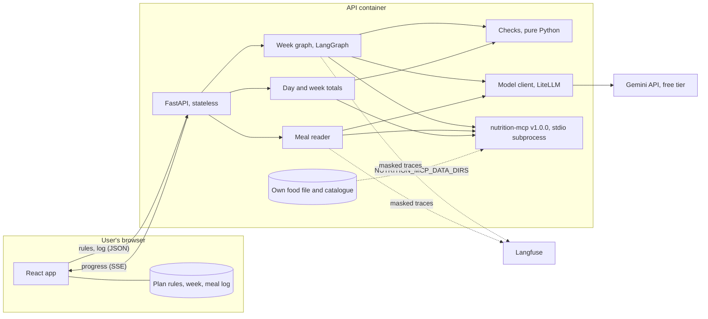
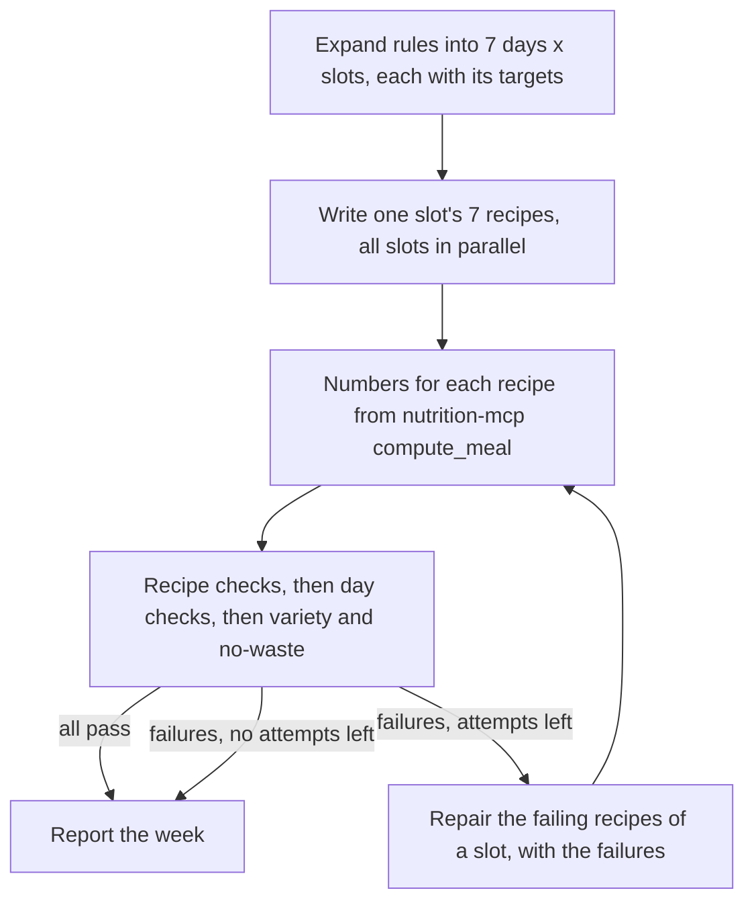

# Architecture

Status: agreed at kickoff, 2026-10-21. What the system must do is in [requirements.md](requirements.md); why it is built this way is in [case-study.md](case-study.md).

## Overview

The browser holds everything about the user. Each request sends the plan rules (and, for summaries, the log) to a stateless API. The model writes recipes and reads typed meals; nutrition-mcp supplies every nutrition number; plain Python decides whether each recipe and day passes. Nothing about the user is written to disk on the server.

## Modules (`src/meal_planner/`)

| Module | Does |
|---|---|
| `rules.py` | Pydantic models for the plan rules (day types, targets, slots, gear, food rules, shopping days) and the JSON Schema export |
| `catalogue.py` | Loads `data/catalogue.yaml`, the ingredients the writer may use, with allergen groups, pack size and shelf life. Checks every id against nutrition-mcp at startup |
| `nutrition.py` | The nutrition-mcp client: one MCP session over stdio, typed wrappers for `search_food`, `get_nutrition` and `compute_meal`, timeouts and error mapping |
| `llm.py` | The model client: model id from config, timeouts, retries with backoff, structured output into Pydantic models, and a log line with tokens, latency and cost for every call. A reply that cannot be used comes back with an error code, never as an exception. Also the fake, recorder and replayer that tests and the smoke eval use |
| `log.py` | JSON log lines on stderr that carry only an allowlist of fields (task, model, tokens, latency, cost, error), so no rule or typed text can reach a log |
| `checks.py` | Pure functions, one per hard check. Each returns pass or fail and a reason the model can act on ("protein 31 g, slot needs at least 36 g") |
| `week.py` | The LangGraph graph that writes, checks and repairs a week |
| `reader.py` | Turns a typed meal into foods and amounts |
| `summary.py` | Day and week totals against targets |
| `api.py` | FastAPI routes, server-sent events, rate limits, CORS |
| `tracing.py` | Langfuse setup and the masking of user content |
| `config.py` | Settings from environment variables (`pydantic-settings`) |

The frontend lives in `frontend/` (React, Vite, TypeScript). It stores the rules, the week and the log in the browser and only displays numbers the API returns.

## Writing a week

1. **Expand (code).** The rules become one entry per day and slot, each with its calorie and protein share of that day type's targets, its style, its time limits and the food rules.
2. **Write (model).** One call per slot writes that slot's 7 recipes together, so the model can see its own recipes and keep them different. The slots run in parallel, with at most `MEAL_PLANNER_MAX_CONCURRENT_MODEL_CALLS` model calls (default 4) in flight at once, so a free-tier rate limit is not hit by every slot together. The call gets the slot's targets, the rules, the cuisines to draw on and the catalogue as a list of ids and names, and returns recipes as structured output with ingredient ids and grams. It is never asked for nutrition numbers.
3. **Numbers (nutrition-mcp).** `compute_meal` gives each recipe's nutrients and glycemic load. An ingredient id outside the catalogue fails the recipe before this step.
4. **Check (code).** Recipe checks first (slot targets, food rules, gear, minutes), then day checks once a day's slots are all in (daily targets, caps and floors), then variety within each slot and no-waste across the week. When a day misses a daily target, the failure is assigned to the recipe that is furthest from its slot's share.
5. **Repair (model).** One call per slot rewrites only that slot's failing recipes. It gets the exact failures and short summaries of the slot's other recipes, so a fix doesn't break variety. A recipe is rewritten at most 3 times (`MEAL_PLANNER_MAX_REPAIR_ATTEMPTS`), so it is tried at most 4 times with the first writing. A day that misses its targets is blamed on one recipe per failed check, and only once the day's recipes pass their own checks. Output that doesn't parse, or has the wrong recipes for the days asked, counts as a failed attempt for the whole slot and the next call is told why; if the slot has no recipes yet it is written again.
6. **Report (code).** Every recipe goes out with its numbers and its check results. A recipe that still fails says what it misses.

A week therefore takes one writing call per slot (4 for a four-slot plan) plus at most 3 repair calls per slot. That keeps it inside free-tier quotas and makes the cost per week predictable.

**Replacing one recipe** runs the same graph for a single day and slot, with the rest of the week passed in for the variety and day checks. The other recipes are not sent to the model or changed. The old recipe leaves the week before the new one is checked, and stays if no new one could be written.

**Why a graph of separate steps instead of one prompt with tools:** the model is good at combining ingredients and flavours and unreliable at arithmetic and rule-following, which nutrition-mcp's grounding run measured. Splitting the work gives each part to whichever side does it reliably, lets the slots run in parallel, and keeps repair targeted and bounded. The single-call baseline in the eval measures whether the extra steps are worth their cost.

## Reading a typed meal

1. **Extract (model).** The typed text becomes a list of items as the user wrote them: a food name, an amount and a unit ("2", "roti"; "1", "katori", "dal"). The text is passed as data in its own field, never as instructions.
2. **Match (nutrition-mcp).** Each name goes to `search_food`. A clear top match is taken. When several are close, the model picks one of nutrition-mcp's results, never a free-form id. With no result, the item is marked missing.
3. **Amount.** A unit nutrition-mcp accepts for that food is passed through. Otherwise the catalogue's grams per measure turn it into grams ("2 eggs" becomes 100 g). A unit neither knows comes back to the user with the valid ones.
4. **Numbers.** `compute_meal` gives the totals. The response lists each item, its match and any missing foods, and the user confirms or edits before the browser saves it.

## Day and week totals

The log holds, for each planned meal, its status and its items as food ids, amounts and units. A summary request sends the log and the rules; the server recomputes each meal with `compute_meal`, adds up each day, and compares the totals with the targets using the same functions as the day checks. A meal's glycemic load is shown only when every item in it has one.

## Data

| Path | Holds |
|---|---|
| `data/foods/` | This project's food file in nutrition-mcp's custom-dataset format: `sources.yaml` (USDA FoodData Central, public domain) and `ingredients.csv` (16 nutrients per 100 g, with an empty cell for a value USDA doesn't report). Loaded by nutrition-mcp through `NUTRITION_MCP_DATA_DIRS` |
| `data/catalogue.yaml` | Every ingredient the writer may use, from nutrition-mcp's bundled data and the food file: id, display name, shop category, allergen groups, typical pack size, days it keeps once opened |
| `scripts/build_foods.py` | Builds `data/foods/ingredients.csv` from a reviewed list of FoodData Central records (needs a free `USDA_FDC_API_KEY`) |
| `evals/datasets/` | Synthetic plans and labelled typed meals |

USDA data has no glycemic index, so a meal with any ingredient from the food file has no glycemic load. The day view says so instead of estimating it.

## Privacy

- The API keeps no state. Rules and logs arrive with each request and are dropped after the response.
- Logs record ids, counts, tokens, latency and cost, never the rules or typed text.
- Traces mask the rules and typed text before they leave the process.
- Export and import in the browser is the only backup. Clearing the browser's storage loses the data, and the UI says so.

## Errors

| Failure | Behaviour |
|---|---|
| nutrition-mcp doesn't start or a call fails | Startup stops with the reason, or the request returns 503 naming the step |
| A catalogue id unknown to nutrition-mcp | Startup stops and names the id |
| Model timeout or rate limit | Retries with backoff; then the slot is reported as not written, with the reason |
| Model output that doesn't parse | Counts as a failed attempt for that slot |
| Invalid rules or log | 422 with the field and the problem |

## Security

- Typed meals and free-text fields in the rules (liked foods, cuisine names) are untrusted. They go to the model as delimited data, model output is parsed into schemas, and the only tools are nutrition-mcp's read-only ones.
- Rate limits and request size limits on every public endpoint; CORS limited to the frontend's origin.
- Keys come from the environment; gitleaks runs in pre-commit and CI.

## Evaluation design

- **Recipe eval.** For each of the 20 synthetic plans, the pipeline and the single-call baseline each write a week, and the same check functions score both. Results go to `evals/results/` with the date, model, commit, dataset version and cost, and `summary.md` puts the headline (share of recipes passing every hard check) in its first row.
- **Reading eval.** About 50 typed meals with labelled foods and grams. Food match is scored per item, and calorie error is computed against the labelled foods' numbers from nutrition-mcp.
- **Smoke eval.** Recorded model responses for a fixed slice are replayed through the real checks and nutrition-mcp, so CI needs no key and gives the same result on every run.

## Deployment

- **Local:** `make run` starts the API (which starts nutrition-mcp) and the Vite dev server.
- **Image:** one Docker image runs the API and nutrition-mcp, installed from its `v1.0.0` tag through the lock file, so nothing is fetched at runtime. CI builds it and runs a smoke request against the container.
- **Public demo (after a yes):** the API on a free Hugging Face Docker Space with its own low-quota key, rate limits and a spend cap; the frontend on GitHub Pages.

## Decided at kickoff

- The user brings a plan; the system writes recipes for it and tracks against it ([0001](decisions/0001-follow-an-existing-plan.md)).
- The model writes, code checks every number and rule, and failures go back with reasons ([0002](decisions/0002-model-writes-code-checks.md)).
- New foods reach nutrition-mcp through its custom-dataset folder, not through changes to it ([0003](decisions/0003-foods-through-nutrition-mcp-datasets.md)).
- The user's data stays in the browser, and the API is stateless ([0004](decisions/0004-user-data-in-the-browser.md)).
